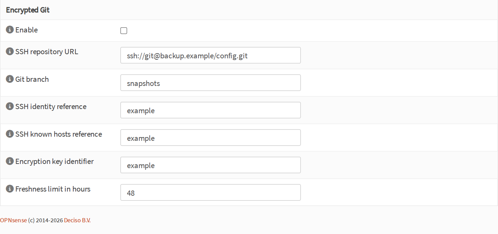
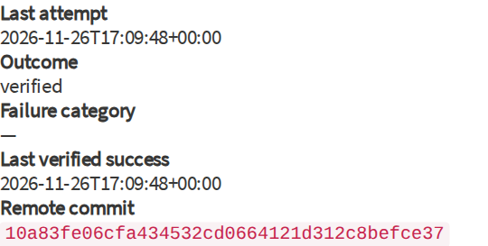

# Install and run your first backup

Start on a test appliance. Plugin v0.1.0 was verified on OPNsense Community
Edition 26.7.9_1, amd64. Run `pkg config ABI`. Continue only if it reports
`FreeBSD:15:amd64`. [Compatibility](compatibility.md)

Already using the plaintext Git backup provider or have a legacy
`/conf/backup/git` repository? Follow [legacy migration](legacy-migration.md)
before enabling this provider. To recover an existing encrypted backup, start
with [restore](recovery.md).

## Verify the signing key

Download the [v0.1.0 public key](https://github.com/vhco-pro/opnsense-encrypted-git-backup/releases/download/v0.1.0/feed-signing-public.pem).
Run this on the appliance from the directory containing the file.

```sh
openssl pkey -pubin -in feed-signing-public.pem -outform DER | sha256 -q
```

Compare all 64 characters with the [published fingerprint](https://pkg.vhco.pro/#signing-key)
and confirm it with a maintainer contact you already trust or another independent
trusted source. Stop if the values differ or you cannot confirm the fingerprint.

## Add the feed and install

Place the verified key at `/usr/local/etc/pkg/vhco-feed-signing-public.pem`,
owned by root and readable by pkg. Save this as
`/usr/local/etc/pkg/repos/vhco.conf`. Leave the OPNsense repositories enabled.

```ucl
VHCO: {
  url: "https://pkg.vhco.pro",
  enabled: yes,
  signature_type: "pubkey",
  pubkey: "/usr/local/etc/pkg/vhco-feed-signing-public.pem"
}
```

Run as root.

```sh
pkg update -f -r VHCO
pkg rquery -U -r VHCO '%n %v' os-encrypted-git-backup
```

Stop on a signature error or if the query does not print
`os-encrypted-git-backup 0.1.0`. Then install and confirm the same version.

```sh
pkg install -r VHCO os-encrypted-git-backup
pkg query '%n %v' os-encrypted-git-backup
```

## Complete a first backup

1. Create a private Git repository. Leave the backup branch uncreated. Give a
   dedicated, unattended SSH identity permission to create and write it. Verify
   the Git server's host key before adding it to a dedicated known-hosts file.
2. Put the SSH identity, known-hosts file and encryption password under
   `/conf/encrypted-git-backup/credentials`. With the reference `example`, name
   them `identity-example`, `hosts-example` and `password-example`. Keep
   independent recovery copies. Set both directories to root-owned mode
   `0700` and each file to root-owned mode `0400` or `0600`, with one link.
3. Write a root-owned mode `0600` temporary file in
   `/conf/encrypted-git-backup/`, then rename it to `activation.json`.
   Substitute your actual SSH URL and branch.

   ```json
   {
     "version": 1,
     "destination": "ssh://git@backup.example/config.git",
     "branch": "snapshots",
     "legacy": null
   }
   ```

4. In **System → Configuration → Backups**, enter the same **SSH repository
   URL** and **Git branch**. If you used the filenames above, enter
   `example` in **SSH identity reference**, **SSH known hosts reference** and
   **Encryption key identifier**. Set **Freshness limit in hours** between 1
   and 8760. Enable and save. Saving can send the first backup immediately.

   [](images/backup-provider.png)

   The Encrypted Git form with example settings before enabling the provider.

5. In **System → Configuration → Encrypted Git Backup**, check that the latest
   **Outcome** is `verified` and **Last verified success** is from this run.
   Compare **Remote commit** with the configured branch tip from a trusted Git
   client. At that commit, check that `config.xml.enc` and `snapshot.json` are
   present and that the file's SHA-256 matches `sha256` in the metadata.

   [](images/verified-backup.png)

   A verified backup receipt. Compare its commit with your remote branch tip.

Once the first backup passes, schedule **Remote backup** in
**System → Settings → Cron** and [try an isolated restore](recovery.md).
