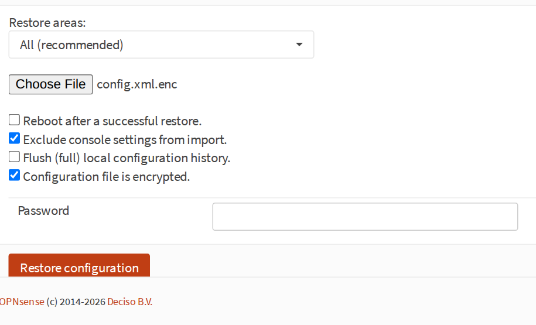

# Restore an encrypted backup

1. On a trusted Git client, open the verified commit on your backup branch.
   Download `config.xml.enc` and `snapshot.json` from that same commit. Check
   that the encrypted file's SHA-256 matches `sha256` in `snapshot.json`.
   Retrieve the password for its `key` from independent recovery storage.
2. Isolate a test appliance before uploading the file. Restoring can bring
   back the saved network identity and services. Open
   **System → Configuration → Backups** on the isolated appliance.
3. In the restore form, leave **Restore areas** at **All (recommended)**.
   Choose `config.xml.enc`, select **Configuration file is encrypted** and enter
   the password. To keep local history, clear **Flush (full) local configuration
   history**. Click **Restore configuration**.

   

   The restore form with the encrypted export selected and the password field open.

4. Keep the appliance isolated while checking that the expected settings
   returned. Reprovision the external credentials from their independent
   copies before enabling delivery.
