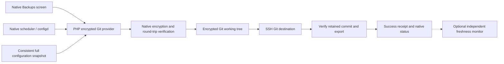

# Plan: Native encrypted Git backup provider

## Context

### Owner summary

Build an installable OPNsense backup provider with its own package and settings in the existing Backups screen.
PHP is the native choice for the provider interface, configuration model and encrypted-export library.
Use OPNsense's standard configuration and scheduling interfaces, with Git and OpenSSH as transport tools.
The project owns reusable behavior, while deployment configuration and the maintained Homelab guides belong in their existing repositories.

The owner selected a separate provider after reviewing upstream feedback.
Earlier encryption work on the existing Git plugin was declined because encrypted snapshots lose readable Git diffs.
Upstream maintainers suggested a separate provider, and a newer request remains open.
We can prepare a focused BSD-2-Clause contribution, with acceptance decided by upstream maintainers.

The provider encrypts the complete configuration before it enters its Git working tree or new history.
Reuse the native encrypted-export format so administrators can restore through the normal OPNsense recovery interface.
Encrypted commits preserve snapshot versions, while readable configuration diffs remain available through native local configuration history.
Randomized ciphertext increases repository growth, so capture cadence and capacity must be explicit.
The initial proposal uses scheduled latest-configuration snapshots with manual runs, reusing the native daily cadence.

Expose remote-success state and clear failure reasons, and retain encrypted pending commits for safe retry.
An independent freshness monitor can detect a stopped firewall or scheduler using non-secret receipt metadata.
The reusable provider supports SSH-accessible Git hosts, with deployment-specific monitor configuration owned by its deployment.

Migration preserves both existing remote history and unpublished local history.
Stop the legacy plaintext writer at a verified checkpoint before accepting new credentials into persistent configuration.
Retain independently recoverable encrypted history and test a real native restore on an isolated appliance.
Secret custody, supported releases and package distribution still need owner choices.
This design phase produces a reviewed specification and installation/recovery design.
Implementation and live rollout follow acceptance of the revised design.

### Verified upstream behavior

The source review on 2026-11-14 used core commit `d20f63c7f7e73c062a623953690c0668070a8d94` and plugins commit `5cca317cdc3e1a979a60b6935428f76de8d08d2b`.
Core `BackupFactory.php:43-58` discovers providers in its own library directory through `IBackupProvider`.
That interface supplies configuration fields, validation/save, provider name, backup execution and enabled state.
Core `diag_backup.php:183-187,374-395` renders discovered fields and dispatches the selected provider's setup/test action.
The remote backup runner dispatches enabled providers and the native scheduler already invokes it.
Provider exceptions can stop the shared runner before later providers execute, so scheduling failure isolation needs proof.
Core `Backup/Base.php` provides encrypted export and decryption, while `opnsense-crypt` calls that same implementation.

The current Git provider is 1.1_5, with its latest directory change on 2026-09-08.
Its PHP provider and configuration-change capture hook form separate paths.
The capture hook continues recording plaintext while remote pushing is disabled.
An encrypted provider must prevent that concurrent legacy path from capturing new credentials during migration.
The current Git provider still builds a `master:<target branch>` push refspec, so the new transport must choose its source ref explicitly.

Upstream encryption request https://github.com/opnsense/plugins/issues/5833 remains open.
Earlier https://github.com/opnsense/plugins/pull/3574 was closed without merge after maintainers suggested a separate provider.
The current contribution guide requires BSD-2-Clause, a discussion before a new plugin submission, a small initial contribution and disclosure of AI tool/model use.

## Scope

Deliver a separate PHP provider with native settings, package lifecycle, scheduling integration, complete encrypted snapshots, SSH Git transport, health evidence and guarded migration.
Provide native installation, upgrade, removal and recovery procedures with synthetic fixtures and disposable-appliance tests.
Use OPNsense's XML model format and native interfaces for externally defined configuration.
The provider's runtime dependencies are OPNsense's existing PHP/core libraries, Git, OpenSSH and OpenSSL.

Readable encrypted-file Git diffs, secret redaction, additional storage backends and automatic destructive history repair are outside this first feature.
Deployment-specific credentials, real configuration exports, external-monitor credentials and production inventories stay in their deployment's protected storage.

## Design

### Provider and ownership

Create a distinct provider implementing `OPNsense\Backup\IBackupProvider` and reusing `OPNsense\Backup\Base` encryption and validation helpers.
Use a unique provider filename in the directory scanned by `BackupFactory` and a separate settings model mount.
The package owns only its own provider, models, status interface, configd registration and version metadata.
Package coexistence must permit disabled migration preparation without replacing core files or the existing Git provider's files.
Enabling encrypted delivery requires proof that the legacy plaintext capture path is inactive.

The Backups screen remains the configuration and setup/test entry point.
The standard provider field contract has no dedicated read-only health field type.
Use a small authenticated status view/API for last attempt, last verified success, remote commit and sanitized failure category, sharing the provider's recorded state.
Use the existing native model/ACL framework for that surface.
Confirm provider-screen privilege handling on every supported release, including read-only users.

### Scheduling and failure isolation

The native provider is callable through setup/test and the existing Remote Backup command.
Validate shared-runner behavior when another enabled provider fails before this provider.
If shared-runner failure isolation is insufficient, expose a dedicated configd action calling the same PHP implementation for a native cron entry.
Assign one daily scheduling owner and verify it through native cron regeneration and package upgrade.
Keep overlap locking and bounded execution in the provider, including manual versus scheduled calls.
The plugin supplies no background daemon or external management-service prerequisite.

### Configuration and secret handling

Settings cover enabled state, SSH repository destination, branch, host trust, deployment identity, encryption credential reference and freshness threshold.
Require SSH host verification and reject credentials embedded in repository URLs.
Validate branch/ref inputs and use safe process argument handling for native Git/OpenSSH commands.
Mandatory encryption prevents a missing or unreadable credential from creating a plaintext backup.
An independent recovery copy must exist before activation, and credentials must never be emitted in status, logs, command arguments or receipt metadata.
The storage contract is Q2 below, because native XML persistence and root-only file custody have different restoration behavior.

Use one versioned key identifier in each encrypted snapshot's metadata.
Credential rotation retains access to earlier snapshots and verifies the newly retained artifact before declaring the rotation complete.
Avoid silent key replacement during repeated setup or package upgrades.
Full configuration remains complete, including recoverable application secrets, inside its encrypted container.

### Snapshot and Git consistency

Capture one consistent complete configuration through the native snapshot/configuration interfaces.
Encrypt through the native library and verify the decrypted bytes against that captured input before staging.
Use a private umask and temporary storage outside the Git working tree.
Permit only encrypted snapshots and explicitly defined non-secret metadata among newly staged backup paths.
Treat native plaintext configuration history on the firewall separately from the provider's encrypted Git storage promise.

Use an explicit source ref such as `HEAD:refs/heads/<configured branch>` and preserve remote history through normal descendant commits.
Reconcile a changed remote before retry and reject divergent or unexpected state with an actionable failure category.
Preserve pending encrypted commits when upload fails.
Record remote success only after an independent read confirms the expected commit and encrypted artifact.
Retries and lost responses must reconcile completed effects before attempting another write.

Record encrypted-artifact hash, captured revision, timestamp, key identifier and verified remote commit with an explicitly documented metadata-privacy boundary.
An independent monitor must check the expected branch and validated receipt schema.
It must distinguish a recent failed attempt from a retained successful export.
Scheduled unchanged configurations still need a remote-verifiable observation without producing a full randomized encrypted blob on every no-op run.
Document storage-growth estimates from measured fixtures and the difference between artifact time and verified source freshness.

### Guarded migration and recovery

Migration is explicit and remains separate from ordinary enablement.
Prepare a preliminary complete legacy Git bundle, encrypt it outside Git and verify an independent retained copy.
Use supported package administration to stop the legacy provider and its config-change hook, then wait for already-running writers to finish.
Capture its final tip, archive it again and verify that exact tip plus the previous remote ancestor through an independent retrieval/decryption path.
Reject a writer or changing tip after the checkpoint.
Only then persist new plugin secrets and enable normal encrypted operation.
Keep the previous verified archive and local recovery data through the transition.

For a repository containing old plaintext history, preserve that history and remove the plaintext snapshot from the new active tree through a normal descendant commit.
Use a no-checkout migration so historical plaintext is never populated into the new active working tree.
Every new configuration snapshot must be encrypted before staging or upload.
Package removal retains backup data and protected recovery material until an explicit data-retirement action.
An upgrade must preserve validated settings, key identifiers and pending Git state.

Recover a full snapshot through native OPNsense decrypt/import using an independently held credential and reachable Git or offline storage.
Use an isolated appliance with production identities and network services contained during restore testing.
Backup delivery and retrieval require no management platform, external vault or additional backup server.
Loss of the deployment key can be handled by issuing a replacement after recovery.

### Packaging and contribution

Build a proper FreeBSD `.pkg` using pinned OPNsense plugin tooling on a compatible disposable build environment.
Expose the package through normal OPNsense package administration.
Q3 chooses initial artifact delivery versus an additional signed repository before public distribution.
Record artifact version, source revision, dependencies, integrity and authenticity checks and supported OPNsense/PHP/FreeBSD combinations.
Native package installation alone does not establish compatibility with an arbitrary older appliance.
Define package file ownership and test install/upgrade/remove before any live rollout.

Keep the source layout and BSD-2-Clause notices suitable for a focused contribution to `opnsense/plugins`.
Revisit existing discussions before proposing a new upstream issue and request owner approval for its exact public text.
Separate generic upstream changes from private deployment instructions and custom distribution infrastructure.
Upstream acceptance remains an external decision.

## Acceptance Criteria

- [ ] AC-01: The package installs and upgrades on the selected supported releases, exposes its provider in the native Backups screen and preserves core and unrelated provider behavior.
- [ ] AC-02: Complete encrypted exports restore through the native OPNsense interface on an isolated appliance, while all newly created provider Git snapshots and staging exclude plaintext configuration and synthetic secrets.
- [ ] AC-03: Validated configuration and secret custody survive the documented restore/upgrade paths, enforce the selected privilege boundary and permit recovery and credential rotation independently of management services.
- [ ] AC-04: Manual and scheduled runs produce consistent Git state under overlap, rejection, interrupted response, retry and divergent-remote cases, with success reflecting independently verified remote retention.
- [ ] AC-05: Native scheduling survives regeneration and upgrade, failure of another provider cannot silently suppress the selected scheduling path, and native status plus independent freshness checking expose stale or failed delivery.
- [ ] AC-06: Migration preserves the verified final legacy history and previous remote ancestor off the firewall, prevents new credentials entering the legacy plaintext capture path and remains recoverable after interruption.
- [ ] AC-07: A second operator can install, configure, observe and recover the provider from versioned documentation and verified package inputs, with supported versions, diff/storage trade-offs and distribution/contribution limits explicit.

## Test Plan

| Criterion | Proof |
| --- | --- |
| AC-01 | On each selected release, build/install the package, inspect provider discovery and native form rendering, exercise setup/test, upgrade and remove/reinstall. Compare core/unrelated file ownership and backup behavior. |
| AC-02 | Use synthetic complete configurations with nested secrets and malformed/encryption-failure inputs. Inspect every newly staged/tracked snapshot, perform native decrypt/import in an isolated appliance and verify the restored fields. Compare a real deployment export only during its separately approved deployment test. |
| AC-03 | Test administrator, read-only and unauthorized access. Verify secret persistence and filesystem modes under the selected custody contract, recovery with independent credentials, failed/complete rotation and old/new snapshot retrieval. Inspect browser/API/log/process outputs for synthetic secret leakage. |
| AC-04 | Inject concurrent manual/cron calls, rejected push, completed push with lost response, process termination and remote branch advance/divergence. Verify exact remote objects, retained pending state, no false success and repeatable recovery. Test non-master local branches and invalid destinations/refs. |
| AC-05 | Regenerate native cron and upgrade the package, then observe a real scheduled run. Make an earlier shared provider fail and prove the selected path still runs or visibly fails its independent health test. Exercise normal, stale, unchanged-source and stopped-scheduler receipts with matching pass/fail expectations. Verify the deployment's owner notification delivery separately. |
| AC-06 | Exercise an old hook appending during the preliminary archive, then stop/drain it and verify the final independently downloaded bundle against the checkpoint tip and remote ancestor. Interrupt each cutover stage and repeat safely. Attempt enablement while the old hook remains active and require rejection before new secrets are saved. |
| AC-07 | Follow the native install/setup/recovery guide from a fresh compatible disposable appliance using only retained package provenance and independent recovery material. Verify package authenticity, document measured repository growth and reproduce upgrade/removal behavior. |

## Tasks

None yet; written after design acceptance.

## Open Questions

### Q1: Which OPNsense releases should the first plugin support?

**Recommendation:** A. Target the current supported stable release first, with a dedicated legacy-migration assessment.

| Option | You get | It costs |
| --- | --- | --- |
| **A. Current stable plus legacy migration assessment** | A maintainable upstream baseline and an explicit path from older installations. | An older production appliance may need a separately planned upgrade before deployment. |
| **B. Current stable and older runtime support** | Potential direct deployment to a legacy appliance if its APIs prove compatible. | Additional build/test matrices and a defined sunset for unsupported platform versions. |

**Why this is yours:** The rollout order and continuing support commitment affect the owner's firewall and future users.

### Q2: Where should unattended encryption and SSH secrets persist?

**Recommendation:** A. Use protected external credential files and keep validated references in the native model.

| Option | You get | It costs |
| --- | --- | --- |
| **A. Protected external credential files** | Explicit filesystem custody and a small XML settings model. | Native XML restore needs a documented credential reprovisioning step and proof of GUI/configd access permissions. |
| **B. Native model secret fields** | Behavior matching existing backup providers and credentials included in full native restoration. | Plaintext configuration and local history hold those secrets under native configuration access permissions. |

**Why this is yours:** This determines recovery convenience, local secret exposure and how the previously selected root-only custody translates into a native plugin.

### Q3: How should the first package be distributed before upstream acceptance?

**Recommendation:** A. Start with a verified versioned package for controlled installation, then design a signed repository when publishing.

| Option | You get | It costs |
| --- | --- | --- |
| **A. Versioned package first** | A small release path using native package installation and explicit upgrade commands. | Operators install selected versions explicitly during the initial phase. |
| **B. Signed third-party package repository immediately** | Firmware-GUI discovery and native update delivery after repository trust is configured. | Repository metadata, signing-key custody, compatibility channels and update-hosting operations. |

**Why this is yours:** Automatic distribution adds a maintained trust and publishing service beyond the provider package.

## Review Log

| Date | Review | Kind | Commit | Model | Isolation | Outcome |
| --- | --- | --- | --- | --- | --- | --- |

## Sources

- [Core provider discovery](https://github.com/opnsense/core/blob/d20f63c7f7e73c062a623953690c0668070a8d94/src/opnsense/mvc/app/library/OPNsense/Backup/BackupFactory.php) and [provider interface](https://github.com/opnsense/core/blob/d20f63c7f7e73c062a623953690c0668070a8d94/src/opnsense/mvc/app/library/OPNsense/Backup/IBackupProvider.php) define discovery and provider entry points.
- [Core Backups screen](https://github.com/opnsense/core/blob/d20f63c7f7e73c062a623953690c0668070a8d94/src/www/diag_backup.php) defines form rendering, setup/test and native decrypt/import.
- [Native backup encryption](https://github.com/opnsense/core/blob/d20f63c7f7e73c062a623953690c0668070a8d94/src/opnsense/mvc/app/library/OPNsense/Backup/Base.php) and [opnsense-crypt](https://github.com/opnsense/core/blob/d20f63c7f7e73c062a623953690c0668070a8d94/src/sbin/opnsense-crypt) define the reusable encryption implementation.
- [Existing Git provider](https://github.com/opnsense/plugins/tree/77648fd1a9ed4f9e99a4997336e30bc33949e629/sysutils/git-backup) supplies current transport/capture behavior and its 1.1_5 package metadata.
- [SFTP provider](https://github.com/opnsense/plugins/tree/5cca317cdc3e1a979a60b6935428f76de8d08d2b/sysutils/sftp-backup) demonstrates native encryption and credential configuration.
- [Plugin framework](https://github.com/opnsense/plugins/blob/5cca317cdc3e1a979a60b6935428f76de8d08d2b/Mk/plugins.mk) defines package build and file ownership tooling.
- [Plugin development](https://docs.opnsense.org/development/examples/helloworld.html) covers PHP, XML models, API, configd and packaging structure.
- [Firmware plugins](https://docs.opnsense.org/manual/firmware.html) describes package administration and plugin discovery.
- [Upstream contribution rules](https://github.com/opnsense/plugins/blob/5cca317cdc3e1a979a60b6935428f76de8d08d2b/CONTRIBUTING.md) govern licensing, proposal discussion, initial scope and AI disclosure.
- [Existing encryption request](https://github.com/opnsense/plugins/issues/5833), [previous encryption PR](https://github.com/opnsense/plugins/pull/3574) and [redaction discussion](https://github.com/opnsense/plugins/pull/4558) establish maintainer feedback and limits on contribution claims.
