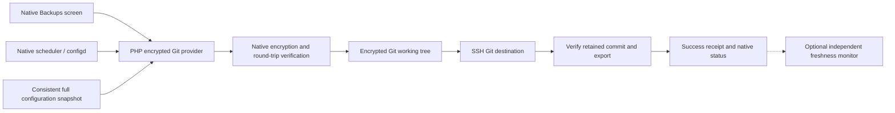

# Plan: Native encrypted Git backup provider

## Context

### Owner summary

Build an installable OPNsense backup provider with its own package and settings in the existing Backups screen.
PHP is the native choice for the provider interface, configuration model and encrypted-export library.
Use OPNsense's standard configuration and scheduling interfaces, with Git and OpenSSH as transport tools.
The project owns reusable behavior, while deployment configuration and the maintained Homelab guides belong in their existing repositories.
The owner selected the current supported stable OPNsense release as the first runtime target, protected external credential files and a signed package repository for the first release.
An older production appliance needs a separately reviewed upgrade and migration path.

The owner selected a separate provider after reviewing upstream feedback.
Earlier encryption work on the existing Git plugin was declined because encrypted snapshots lose readable Git diffs.
Upstream maintainers suggested a separate provider, and a newer request remains open.
We can prepare a focused BSD-2-Clause contribution, with acceptance decided by upstream maintainers.

The provider encrypts the complete configuration before it enters its Git working tree or new history.
Reuse the native encrypted-export format so administrators can restore through the normal OPNsense recovery interface.
Encrypted commits preserve snapshot versions, while readable configuration diffs remain available through native local configuration history.
Randomized ciphertext increases repository growth, so capture cadence and capacity must be explicit.
The initial proposal uses scheduled latest-configuration snapshots with manual runs, reusing the native daily cadence.

Expose remote-success state and clear failure reasons, and retain encrypted pending commits for safe retry.
An independent freshness monitor can detect a stopped firewall or scheduler using non-secret receipt metadata.
The reusable provider supports SSH-accessible Git hosts, with deployment-specific monitor configuration owned by its deployment.

Migration preserves both existing remote history and unpublished local history.
Stop the legacy plaintext writer at a verified checkpoint before accepting new credentials into persistent configuration.
Retain independently recoverable encrypted history and test a real native restore on an isolated appliance.
Shared PHP conventions now define typing, small effect boundaries, PSR-12, secure resources and explicit development checks.
The implementation must pass style, static analysis and behavior tests with recorded coverage of owned files.
Development tools are kept in the build/test environment.
The owner requires managed static hosting for the signed repository and approved implementation after the Cloudflare Pages clarification.
The selected direction is a static Cloudflare Pages feed with managed HTTPS and an operator-configured public hostname.
This design phase produces a reviewed specification and installation/recovery design.
Implementation and live rollout follow acceptance of the revised design.

### Verified upstream behavior

The source review on 2026-11-14 used core commit `d20f63c7f7e73c062a623953690c0668070a8d94` and plugins commit `5cca317cdc3e1a979a60b6935428f76de8d08d2b`.
Core `BackupFactory.php:43-58` discovers providers in its own library directory through `IBackupProvider`.
That interface supplies configuration fields, validation/save, provider name, backup execution and enabled state.
Core `diag_backup.php:183-187,374-395` renders discovered fields and dispatches the selected provider's setup/test action.
The remote backup runner dispatches enabled providers and the native scheduler already invokes it.
At that core revision, the remote runner catches each provider's ordinary exception, continues subsequent providers and reports aggregate failure after the loop.
Older release behavior must be assessed separately through the compatibility matrix.
Core `Backup/Base.php` provides encrypted export and decryption, while `opnsense-crypt` calls that same implementation.

The current Git provider is 1.1_5, with its latest directory change on 2026-09-08.
Its PHP provider and configuration-change capture hook form separate paths.
The capture hook continues recording plaintext while remote pushing is disabled.
An encrypted provider must prevent that concurrent legacy path from capturing new credentials during migration.
The current Git provider still builds a `master:<target branch>` push refspec, so the new transport must choose its source ref explicitly.

Upstream encryption request https://github.com/opnsense/plugins/issues/5833 remains open.
Earlier https://github.com/opnsense/plugins/pull/3574 was closed without merge after maintainers suggested a separate provider.
The current contribution guide requires BSD-2-Clause, a discussion before a new plugin submission, a small initial contribution and disclosure of AI tool/model use.

## Scope

Deliver a separate PHP provider with native settings, package lifecycle, scheduling integration, complete encrypted snapshots, SSH Git transport, health evidence and guarded migration.
Include a signed package repository and documented client trust bootstrap in the first release.
Provide native installation, upgrade, removal and recovery procedures with synthetic fixtures and disposable-appliance tests.
Use OPNsense's XML model format and native interfaces for externally defined configuration.
The provider's runtime dependencies are OPNsense's existing PHP/core libraries, Git, OpenSSH and OpenSSL.

Readable encrypted-file Git diffs, secret redaction, additional storage backends and automatic destructive history repair are outside this first feature.
Deployment-specific credentials, real configuration exports, external-monitor credentials and production inventories stay in their deployment's protected storage.

## Design

### PHP quality and compatibility

Follow the shared [PHP convention](https://github.com/vhco-pro/docs/blob/d59008a3d135dfac17e93033a854dc67065d7a40/conventions/php.md), pinned by AGENTS.md.
That immutable revision merged through https://github.com/vhco-pro/docs/pull/37 and preserves the PHP and browser guidance independently reviewed in R-4.
Use OPNsense's PSR-12 style and preserve its exact provider/model interface signatures.
Use native types and strict typing for owned implementation where compatible with those signatures and actual framework callers.
Validate model/XML/request input before conversion and confine unavoidable dynamic types to tested integration boundaries.
Keep configuration, Git and filesystem effects explicit and avoid parallel service containers or generic abstraction layers.

Configure PHP_CodeSniffer, PHPStan and PHPUnit as pinned development-only dependencies.
The quality target for owned source and tests is PHPStan's maximum supported rule level, with exact platform symbols and precise stubs where required.
Any measured interoperability gap needs a narrow documented exception and independent review, with the affected paths and checks visible.
An empty analysis target, missing framework symbols, broad baseline or suppressed runtime failure cannot satisfy quality acceptance.
Record actual interpreter/extension versions, tool versions, source/test inclusions and exact commands in the repository after observing them.
Native package contents exclude developer dependencies and private fixtures.
Run syntax and style checks, static analysis and behavior tests in CI, plus package/integration tests on a compatible disposable OPNsense/FreeBSD environment.
Native browser settings and status pages also follow the pinned frontend-testing standard.
Provide owned repeatable synthetic appliance fixtures and an automated Playwright suite for settings/setup, reload persistence, success/failure status and permission boundaries.
Run Chromium journeys and Firefox for authentication, redirects and state-sensitive flows, plus the applicable responsive, keyboard, zoom and supported-theme checks.
Keep fixture preparation and cleanup scoped to disposable test appliances and out of normal package installation.
Browser tooling and its lock file remain developer-only inputs.

Resolve and pin the exact current stable release, PHP runtime and FreeBSD ABI from official release/package metadata before implementation starts.
Legacy-release support is limited to an assessed migration path.
The production firewall upgrade belongs in the Lab rollout and its own bounded maintenance approval.

### Provider and ownership

Create a distinct provider implementing `OPNsense\Backup\IBackupProvider` and reusing `OPNsense\Backup\Base` encryption and validation helpers.
Use a unique provider filename in the directory scanned by `BackupFactory` and a separate settings model mount.
The package owns only its own provider, models, status interface, configd registration and version metadata.
Package coexistence must permit disabled migration preparation without replacing core files or the existing Git provider's files.
Enabling encrypted delivery requires proof that the legacy plaintext capture path is inactive.

The Backups screen remains the configuration and setup/test entry point.
The standard provider field contract has no dedicated read-only health field type.
Use a small authenticated status view/API for last attempt, last verified success, remote commit and sanitized failure category, sharing the provider's recorded state.
Use the existing native model/ACL framework for that surface.
Confirm provider-screen privilege handling on every supported release, including read-only users.

### Scheduling and failure isolation

The native provider is callable through setup/test and the existing Remote Backup command.
Reuse native Remote Backup scheduling and verify that an earlier provider's ordinary exception allows this provider to execute while the shared run reports failure.
Assign the existing daily job as scheduling owner and verify it through native cron regeneration and package upgrade.
Any older runtime target must prove equivalent behavior or return through design review before adding a separate scheduling path.
Keep overlap locking and bounded execution in the provider, including manual versus scheduled calls.
The plugin supplies no background daemon or external management-service prerequisite.

### Configuration and secret handling

Settings cover enabled state, SSH repository destination, branch, host trust, deployment identity, encryption credential reference and freshness threshold.
Require SSH host verification and reject credentials embedded in repository URLs.
Validate branch/ref inputs and use safe process argument handling for native Git/OpenSSH commands.
Mandatory encryption prevents a missing or unreadable credential from creating a plaintext backup.
An independent recovery copy must exist before activation, and credentials must never be emitted in status, logs, command arguments or receipt metadata.
Store SSH private keys and unattended encryption passwords in root-owned protected files outside the native XML model.
The model stores validated references and non-secret settings.
Reprovision these files from independently held credentials after native XML restoration.
Use authenticated native UI/API actions and privileged configd operations for provisioning and use, with explicit read-only-user rejection.
Ensure native complete configuration exports exclude those external files, while the separately retained recovery material remains usable independently.

Use one versioned key identifier in each encrypted snapshot's metadata.
Credential rotation retains access to earlier snapshots and verifies the newly retained artifact before declaring the rotation complete.
Avoid silent key replacement during repeated setup or package upgrades.
Full configuration remains complete, including recoverable application secrets, inside its encrypted container.

### Snapshot and Git consistency

Capture one consistent complete configuration through the native snapshot/configuration interfaces.
Encrypt through the native library and verify the decrypted bytes against that captured input before staging.
Use a private umask and temporary storage outside the Git working tree.
Permit only encrypted snapshots and explicitly defined non-secret metadata among newly staged backup paths.
Treat native plaintext configuration history on the firewall separately from the provider's encrypted Git storage promise.

Use an explicit source ref such as `HEAD:refs/heads/<configured branch>` and preserve remote history through normal descendant commits.
Reconcile a changed remote before retry and reject divergent or unexpected state with an actionable failure category.
Preserve pending encrypted commits when upload fails.
Record remote success only after an independent read confirms the expected commit and encrypted artifact.
Retries and lost responses must reconcile completed effects before attempting another write.

Record encrypted-artifact hash, captured revision, timestamp, key identifier and verified remote commit with an explicitly documented metadata-privacy boundary.
An independent monitor must check the expected branch and validated receipt schema.
It must distinguish a recent failed attempt from a retained successful export.
Scheduled unchanged configurations still need a remote-verifiable observation without producing a full randomized encrypted blob on every no-op run.
Document storage-growth estimates from measured fixtures and the difference between artifact time and verified source freshness.

### Guarded migration and recovery

Migration is explicit and remains separate from ordinary enablement.
Prepare a preliminary complete legacy Git bundle, encrypt it outside Git and verify an independent retained copy.
Use supported package administration to stop the legacy provider and its config-change hook, then wait for already-running writers to finish.
Capture its final tip, archive it again and verify that exact tip plus the previous remote ancestor through an independent retrieval/decryption path.
Reject a writer or changing tip after the checkpoint.
Only then persist new plugin secrets and enable normal encrypted operation.
Keep the previous verified archive and local recovery data through the transition.

For a repository containing old plaintext history, preserve that history and remove the plaintext snapshot from the new active tree through a normal descendant commit.
Use a no-checkout migration so historical plaintext is never populated into the new active working tree.
Every new configuration snapshot must be encrypted before staging or upload.
Package removal retains backup data and protected recovery material until an explicit data-retirement action.
An upgrade must preserve validated settings, key identifiers and pending Git state.

Recover a full snapshot through native OPNsense decrypt/import using an independently held credential and reachable Git or offline storage.
Use an isolated appliance with production identities and network services contained during restore testing.
Backup delivery and retrieval require no management platform, external vault or additional backup server.
Loss of the deployment key can be handled by issuing a replacement after recovery.

### Packaging and contribution

Build a proper FreeBSD `.pkg` using pinned OPNsense plugin tooling on a compatible disposable build environment.
Expose the package through normal OPNsense package administration.
The first release includes a signed third-party package repository with native client trust configuration and Firmware-GUI discovery/update verification.
Generate catalogue metadata and signatures through the compatible native pkg tooling and publish immutable versioned package artifacts.
Clients verify the configured repository trust before accepting catalogue updates and verify artifact integrity against that trusted metadata.
Distribute the initial trusted key/fingerprint through a separately verified release identity, then document key rotation and revocation.
Keep signing private keys outside source and package artifacts, with independently retained recovery material.
Publish a complete validated repository generation so interrupted publication preserves a usable previous generation.
Choose compatible release/ABI channels explicitly and refuse an incompatible package on the target.
Use managed Cloudflare Pages static public hosting for the signed feed.
The owner requires managed serverless/static hosting and wants no instance-maintenance responsibility.
The Cloudflare Pages feed serves static catalogue, signature and package files over managed HTTPS.
Its publication pipeline and signing-key lifecycle remain project responsibilities.
Validate artifact count/size limits, response behavior and native client compatibility before selecting the final feed configuration.
Retain immutable package versions needed by cached catalogues across repository generations and test an update during catalogue/artifact retrieval.
Record artifact version, source revision, dependencies, integrity and authenticity checks and supported OPNsense/PHP/FreeBSD combinations.
Native package installation alone does not establish compatibility with an arbitrary older appliance.
Define package file ownership and test install/upgrade/remove before any live rollout.

Keep the source layout and BSD-2-Clause notices suitable for a focused contribution to `opnsense/plugins`.
Revisit existing discussions before proposing a new upstream issue and request owner approval for its exact public text.
Separate generic upstream changes from private deployment instructions and custom distribution infrastructure.
Upstream acceptance remains an external decision.

## Acceptance Criteria

- [ ] AC-01: The package installs and upgrades on the selected supported releases, exposes its provider in the native Backups screen and preserves core and unrelated provider behavior.
- [ ] AC-02: Complete encrypted exports restore through the native OPNsense interface on an isolated appliance, while all newly created provider Git snapshots and staging exclude plaintext configuration and synthetic secrets.
- [ ] AC-03: Validated configuration and secret custody survive the documented restore/upgrade paths, enforce the selected privilege boundary and permit recovery and credential rotation independently of management services.
- [ ] AC-04: Manual and scheduled runs produce consistent Git state under overlap, rejection, interrupted response, retry and divergent-remote cases, with success reflecting independently verified remote retention.
- [ ] AC-05: Native scheduling survives regeneration and upgrade, failure of another provider cannot silently suppress the selected scheduling path, and native status plus independent freshness checking expose stale or failed delivery.
- [ ] AC-06: Migration preserves the verified final legacy history and previous remote ancestor off the firewall, prevents new credentials entering the legacy plaintext capture path and remains recoverable after interruption.
- [ ] AC-07: A second operator can install, configure, observe and recover the provider from versioned documentation and verified package inputs, with supported versions, diff/storage trade-offs and distribution/contribution limits explicit.
- [ ] AC-08: Owned PHP source and tests pass the selected runtime syntax checks, PSR-12 style, declared static-analysis checks and behavior tests with visible file coverage and reviewed narrow exceptions, while the runtime package excludes development tooling and private fixtures.
- [ ] AC-09: The signed repository supports verified native installation and updates on the selected runtime, rejects untrusted catalogues, modified packages and incompatible targets, and preserves recoverable trust and a usable repository generation through failed publication and signing-key rotation.
- [ ] AC-10: The native settings and status interfaces pass reproducible automated browser journeys for setup, reload persistence, success/failure states and permissions on owned disposable fixtures, with the applicable responsive and accessibility checks and developer tooling excluded from the runtime package.

## Test Plan

| Criterion | Proof |
| --- | --- |
| AC-01 | On each selected release, build/install the package, inspect provider discovery and native form rendering, exercise setup/test, upgrade and remove/reinstall. Compare core/unrelated file ownership and backup behavior. |
| AC-02 | Use synthetic complete configurations with nested secrets and malformed/encryption-failure inputs. Inspect every newly staged/tracked snapshot, perform native decrypt/import in an isolated appliance and verify the restored fields. Compare a real deployment export only during its separately approved deployment test. |
| AC-03 | Test administrator, read-only and unauthorized access. Verify secret persistence and filesystem modes under the selected custody contract, recovery with independent credentials, failed/complete rotation and old/new snapshot retrieval. Inspect browser/API/log/process outputs for synthetic secret leakage. |
| AC-04 | Inject concurrent manual/cron calls, rejected push, completed push with lost response, process termination and remote branch advance/divergence. Verify exact remote objects, retained pending state, no false success and repeatable recovery. Test non-master local branches and invalid destinations/refs. |
| AC-05 | Regenerate native cron and upgrade the package, then observe a real scheduled run. Make an earlier shared provider fail and prove the selected path still runs or visibly fails its independent health test. Exercise normal, stale, unchanged-source and stopped-scheduler receipts with matching pass/fail expectations. Verify the deployment's owner notification delivery separately. |
| AC-06 | Exercise an old hook appending during the preliminary archive, then stop/drain it and verify the final independently downloaded bundle against the checkpoint tip and remote ancestor. Interrupt each cutover stage and repeat safely. Attempt enablement while the old hook remains active and require rejection before new secrets are saved. |
| AC-07 | Follow the native install/setup/recovery guide from a fresh compatible disposable appliance using only retained package provenance and independent recovery material. Verify package authenticity, document measured repository growth and reproduce upgrade/removal behavior. |
| AC-08 | On the pinned target interpreter, run syntax checks, PHP_CodeSniffer PSR-12, PHPStan at the declared maximum-level target with platform symbols/stubs, and PHPUnit over actual owned source/tests. Record resolved versions, scanned files, exclusions and any independently reviewed exception. Inspect the built package for development dependencies and private fixtures. Verify real platform interfaces separately through AC-01 to AC-07. |
| AC-09 | Bootstrap repository trust on a fresh compatible appliance, install through native firmware/package administration and update a version. Reject an unsigned/wrong-key catalogue, a changed artifact and incompatible ABI. Interrupt repository publication and prove the previous generation still installs. Exercise signing-key rotation, revoked-key rejection and recovery using independent signing/recovery material without exposing keys. |
| AC-10 | Prepare and repeat owned synthetic appliance fixtures without duplicating users or triggering external effects. Run Playwright through native settings/setup, reload persistence, normal/failed status and administrator/read-only/unauthorized cases. Exercise applicable Chromium/Firefox, responsive, keyboard, zoom and supported-theme coverage through real UI actions, with retained screenshots and console checks. Verify cleanup ownership and package exclusion of browser tools and private fixtures. |

## Tasks

- [ ] T1 `docs/compatibility.md` - resolve the stable release and hotfix to immutable platform and builder inputs and verify the provider, scheduler and restore contracts at those revisions (Design)
- [ ] T2 `composer.json`, `composer.lock`, `phpcs.xml.dist`, `phpstan.neon`, `phpunit.xml.dist`, `tests/` - install the locked development tools and observe contract and credential-validation tests fail against the absent provider (AC-01, AC-03, AC-08)
- [ ] T3 `src/`, `tests/` - pass native adapter, XML model, protected credential reference and legacy-writer rejection tests (AC-01, AC-03, AC-06)
- [ ] T4 `src/`, `tests/` - pass tests for complete native encryption, exact round-trip verification, input failures and staging allowlists (AC-02)
- [ ] T5 `src/`, `tests/` - pass integration tests for Git reconciliation, bounded SSH execution, overlap, rejected pushes, lost responses and verified remote receipts (AC-04, AC-05)
- [ ] T6 `src/`, `tests/` - pass migration tests for verified off-appliance archives, interrupted cutover and no-checkout preservation of remote history (AC-06)
- [ ] T7 `src/`, `tests/` - verify native ACLs, sanitized status, freshness checks and recovery across credential rotation (AC-03, AC-05, AC-10)
- [ ] T8 `Makefile`, `pkg-descr`, `tests/` - build native install and upgrade artifacts and verify package contents, ownership and removal behavior on the pinned appliance (AC-01, AC-07, AC-08)
- [ ] T9 `tests/`, `docs/installation.md`, `docs/recovery.md` - verify native signed-feed generation, trusted installation, negative trust and ABI cases, retained generations and key rotation in isolated scope (AC-07, AC-09)
- [ ] T10 `tests/`, `playwright.config.ts`, `package.json`, `bun.lock` - run synthetic appliance journeys in Chromium and Firefox and retain responsive and accessibility evidence (AC-10)
- [ ] T11 `tests/`, `docs/compatibility.md`, `docs/installation.md`, `docs/recovery.md`, `.github/workflows/` - reproduce installation, native restore and scheduling, record measured growth and tool coverage, and verify that CI runs the declared checks (AC-01, AC-02, AC-03, AC-05, AC-07, AC-08)

## Open Questions

None. The public hostname, publication credentials and trusted signing identity are deployment inputs selected and verified before a separately approved public release.

## Review Log

| Date | Review | Kind | Commit | Model | Isolation | Outcome |
| --- | --- | --- | --- | --- | --- | --- |
| 2026-11-14 | R-1 | spec | `fe017181fab3d0a407d53708757f720adb32b947` | unknown | procedural | Blocking current-core scheduling claim corrected; model identity not attested. |
| 2026-11-14 | R-2 | spec | `60850674d58ac855a509af22132174201972ffd2` | unknown | procedural | NO FINDINGS; model identity not attested. |
| 2026-11-14 | R-3 | spec | `ab93ef6d9f5a6dcd9c47f1b452cc978665adc027` | unknown | procedural | Blocking strict-typing clarification and missing browser proof identified; model identity not attested. |
| 2026-11-14 | R-4 | spec | `30e0b629bfdc280f80404cf6fbd6af993ba287ca` | unknown | procedural | NO FINDINGS; authoritative PHP guidance and browser proof rechecked, model identity not attested. |
| 2026-11-14 | R-5 | spec | `bd68964bd5f20998d28af78743413123b24f6f01` | unknown | procedural | NO FINDINGS; merged guidance and managed-feed clarification rechecked, model identity not attested. |
| 2026-11-14 | R-5 | spec | `bd68964bd5f20998d28af78743413123b24f6f01` | n/a | n/a | accepted by owner |

### R-1

FINDING: F-01
KIND: factual
SEVERITY: blocking
WHERE: Context / Verified upstream behavior; Design / Scheduling and failure isolation; Test Plan / AC-05
EVIDENCE: At reviewed commit fe017181fab3d0a407d53708757f720adb32b947, the spec attributes possible suppression of later providers to the cited current core and conditionally proposes a dedicated configd scheduling action. I fetched src/opnsense/scripts/system/remote_backup.php at the cited core commit d20f63c7f7e73c062a623953690c0668070a8d94. Its provider loop wraps each backup() call in try/catch(Exception), accumulates errors, continues subsequent providers and returns failure after the loop. Ordinary provider exceptions therefore have isolation in this version. The spec's premise could lead to an unnecessary second scheduling path.
PROPOSAL: Describe the current runner's observed exception isolation and identify any older-release behavior separately. Reuse native Remote Backup scheduling for the current baseline, with regression proof for an earlier provider throwing an exception. Retain a dedicated scheduling action only if a supported release or a specifically reproduced failure requires it.

### R-2

NO FINDINGS

### R-3

FINDING: F-01
KIND: factual
SEVERITY: blocking
WHERE: Adopted conventions/php.md / Types and input boundaries; Design / PHP quality and compatibility
EVIDENCE: The adopted PHP guideline at revision 66582497a21a2181521e7d77200608af597dcc89, lines 27-31, discusses parameter, property and return declarations, then states that strict typing is selected by the calling file. This omits the distinction for scalar return checks. The implemented PHP RFC https://wiki.php.net/rfc/scalar_type_hints_v5, sections Parameter type declarations and Return type declarations, establishes that scalar argument checking follows the calling file, while scalar return checking follows the file defining the function. The cited PHP manual also demonstrates strict return checking. Applying the broad statement to framework integration would produce incorrect coercion expectations and tests.
PROPOSAL: Qualify the caller-file rule as applying to scalar argument checks and state the definition-file rule for scalar return checks. Preserve explicit input validation and actual framework-call compatibility tests. Update the adopted immutable documentation revision after correcting the authoritative guideline.

FINDING: F-02
KIND: factual
SEVERITY: should-fix
WHERE: Design / PHP quality and compatibility; Design / Provider and ownership; Acceptance Criteria and Test Plan
EVIDENCE: At reviewed plugin commit ab93ef6d9f5a6dcd9c47f1b452cc978665adc027, the feature adds native settings and a browser status view, but its verification design and criteria cover PHP checks, package tests and native form inspection without an automated browser suite. The adopted shared AGENTS.md at revision 66582497a21a2181521e7d77200608af597dcc89, lines 14-15, routes every browser frontend to conventions/frontend-testing.md. That standard requires reproducible owned fixtures and automated Playwright journeys, including browser actions, persistence, permission states and responsive verification. Existing proofs could pass while those required browser behaviors remain untested.
PROPOSAL: Add the applicable frontend-testing requirement to the feature design and observable proof. Use synthetic state on a disposable appliance to exercise settings/setup, reload persistence, successful and failed status, and access permissions through the real browser interface. Include the resulting owned browser test paths in covers and retain the existing boundary between disposable tests and live deployment.

### R-4

NO FINDINGS

### R-5

NO FINDINGS

## Sources

- [Shared PHP convention](https://github.com/vhco-pro/docs/blob/d59008a3d135dfac17e93033a854dc67065d7a40/conventions/php.md) supplies the implementation and verification rules, with primary-source links for each subject.
- [Shared browser verification standard](https://github.com/vhco-pro/docs/blob/d59008a3d135dfac17e93033a854dc67065d7a40/conventions/frontend-testing.md) supplies the owned-fixture and automated browser proof requirements.
- [Cloudflare Pages static hosting](https://developers.cloudflare.com/pages/framework-guides/deploy-anything/) and [limits](https://developers.cloudflare.com/pages/platform/limits/) describe the proposed managed hosting model and the limits to verify before feed publication.
- [FreeBSD pkg repository tooling](https://man.freebsd.org/cgi/man.cgi?query=pkg-repo&sektion=8&format=html) defines native catalogue creation/signing and repository metadata.

- [Core provider discovery](https://github.com/opnsense/core/blob/d20f63c7f7e73c062a623953690c0668070a8d94/src/opnsense/mvc/app/library/OPNsense/Backup/BackupFactory.php) and [provider interface](https://github.com/opnsense/core/blob/d20f63c7f7e73c062a623953690c0668070a8d94/src/opnsense/mvc/app/library/OPNsense/Backup/IBackupProvider.php) define discovery and provider entry points.
- [Current remote backup runner](https://github.com/opnsense/core/blob/d20f63c7f7e73c062a623953690c0668070a8d94/src/opnsense/scripts/system/remote_backup.php) isolates ordinary provider exceptions and reports aggregate failure after processing enabled providers.
- [Core Backups screen](https://github.com/opnsense/core/blob/d20f63c7f7e73c062a623953690c0668070a8d94/src/www/diag_backup.php) defines form rendering, setup/test and native decrypt/import.
- [Native backup encryption](https://github.com/opnsense/core/blob/d20f63c7f7e73c062a623953690c0668070a8d94/src/opnsense/mvc/app/library/OPNsense/Backup/Base.php) and [opnsense-crypt](https://github.com/opnsense/core/blob/d20f63c7f7e73c062a623953690c0668070a8d94/src/sbin/opnsense-crypt) define the reusable encryption implementation.
- [Existing Git provider](https://github.com/opnsense/plugins/tree/77648fd1a9ed4f9e99a4997336e30bc33949e629/sysutils/git-backup) supplies current transport/capture behavior and its 1.1_5 package metadata.
- [SFTP provider](https://github.com/opnsense/plugins/tree/5cca317cdc3e1a979a60b6935428f76de8d08d2b/sysutils/sftp-backup) demonstrates native encryption and credential configuration.
- [Plugin framework](https://github.com/opnsense/plugins/blob/5cca317cdc3e1a979a60b6935428f76de8d08d2b/Mk/plugins.mk) defines package build and file ownership tooling.
- [Plugin development](https://docs.opnsense.org/development/examples/helloworld.html) covers PHP, XML models, API, configd and packaging structure.
- [Firmware plugins](https://docs.opnsense.org/manual/firmware.html) describes package administration and plugin discovery.
- [Upstream contribution rules](https://github.com/opnsense/plugins/blob/5cca317cdc3e1a979a60b6935428f76de8d08d2b/CONTRIBUTING.md) govern licensing, proposal discussion, initial scope and AI disclosure.
- [Existing encryption request](https://github.com/opnsense/plugins/issues/5833), [previous encryption PR](https://github.com/opnsense/plugins/pull/3574) and [redaction discussion](https://github.com/opnsense/plugins/pull/4558) establish maintainer feedback and limits on contribution claims.
