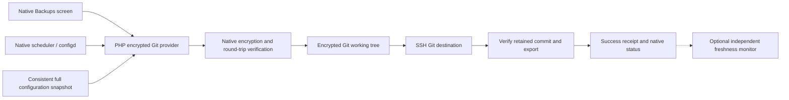

# Plan: Native encrypted Git backup provider

## Context

### Owner summary

Build an installable OPNsense backup provider with its own package and settings in the existing Backups screen.
PHP is the native choice for the provider interface, configuration model and encrypted-export library.
Use OPNsense's standard configuration and scheduling interfaces, with Git and OpenSSH as transport tools.
The project owns reusable behavior, while deployment configuration and the maintained Homelab guides belong in their existing repositories.
The owner selected the current supported stable OPNsense release as the first runtime target, protected external credential files and a signed package repository for the first release.
An older production appliance needs a separately reviewed upgrade and migration path.

The owner selected a separate provider after reviewing upstream feedback.
Earlier encryption work on the existing Git plugin was declined because encrypted snapshots lose readable Git diffs.
Upstream maintainers suggested a separate provider, and a newer request remains open.
We can prepare a focused BSD-2-Clause contribution, with acceptance decided by upstream maintainers.

The provider encrypts the complete configuration before it enters its Git working tree or new history.
Reuse the native encrypted-export format so administrators can restore through the normal OPNsense recovery interface.
Encrypted commits preserve snapshot versions, while readable configuration diffs remain available through native local configuration history.
Randomized ciphertext increases repository growth, so capture cadence and capacity must be explicit.
The initial proposal uses scheduled latest-configuration snapshots with manual runs, reusing the native daily cadence.

Expose remote-success state and clear failure reasons, and retain encrypted pending commits for safe retry.
An independent freshness monitor can detect a stopped firewall or scheduler using non-secret receipt metadata.
The reusable provider supports SSH-accessible Git hosts, with deployment-specific monitor configuration owned by its deployment.

Migration preserves both existing remote history and unpublished local history.
Stop the legacy plaintext writer at a verified checkpoint before accepting new credentials into persistent configuration.
Retain independently recoverable encrypted history and verify a separate native encrypted export of the current pre-cutover configuration before saving new credentials. That export remains the recovery point until the first encrypted delivery is verified.
Shared PHP conventions now define typing, small effect boundaries, PSR-12, secure resources and explicit development checks.
The implementation must pass style, static analysis and behavior tests with recorded coverage of owned files.
Development tools are kept in the build/test environment.
The owner selected an owner-dispatched GitHub Actions workflow for a signed Cloudflare Pages feed. The selection authorizes fixture verification. Production dispatch, signing material, Pages credentials, hostname and publication require separate owner approval.
The installed fixture demonstrated signed package installation, key rotation for backup encryption and native restoration. The release workflow and native feed promotion and rollback tests remain open. An unresolved production submission leaves publication on hold, potentially indefinitely, and preserves the currently served state, which may be catalogue absence during first publication.
The pinned PHP action and shared GitVersion dry run passed consumer CI. A native fixture confirmed that the exact-source package and signed catalogue report the same derived version. After separate release authorization, the shared workflow owns automatic tags and the feed dispatch verifies and consumes them. Required scans must cover the declared inputs, and findings require a fix or an independently reviewed owner disposition. The Python advisory remains open. The revised specification needs independent review and renewed acceptance.

### Verified upstream behavior

The source review on 2026-11-14 used core commit `d20f63c7f7e73c062a623953690c0668070a8d94` and plugins commit `5cca317cdc3e1a979a60b6935428f76de8d08d2b`.
Core `BackupFactory.php:43-58` discovers providers in its own library directory through `IBackupProvider`.
That interface supplies configuration fields, validation/save, provider name, backup execution and enabled state.
Core `diag_backup.php:183-187,374-395` renders discovered fields and dispatches the selected provider's setup/test action.
The remote backup runner dispatches enabled providers and the native scheduler already invokes it.
At that core revision, the remote runner catches each provider's ordinary exception, continues subsequent providers and reports aggregate failure after the loop.
Older release behavior must be assessed separately through the compatibility matrix.
Core `Backup/Base.php` provides encrypted export and decryption, while `opnsense-crypt` calls that same implementation.

The current Git provider is 1.1_5, with its latest directory change on 2026-09-08.
Its PHP provider and configuration-change capture hook form separate paths.
The capture hook continues recording plaintext while remote pushing is disabled.
An encrypted provider must prevent that concurrent legacy path from capturing new credentials during migration.
The current Git provider still builds a `master:<target branch>` push refspec, so the new transport must choose its source ref explicitly.

Upstream encryption request https://github.com/opnsense/plugins/issues/5833 remains open.
Earlier https://github.com/opnsense/plugins/pull/3574 was closed without merge after maintainers suggested a separate provider.
The current contribution guide requires BSD-2-Clause, a discussion before a new plugin submission, a small initial contribution and disclosure of AI tool/model use.

## Scope

Deliver a separate PHP provider with native settings, package lifecycle, scheduling integration, complete encrypted snapshots, SSH Git transport, health evidence and guarded migration.
Include a signed package repository and documented client trust bootstrap in the first release.
Provide native installation, upgrade, removal and recovery procedures with synthetic fixtures and disposable-appliance tests.
Use OPNsense's XML model format and native interfaces for externally defined configuration.
The provider's runtime dependencies are OPNsense's existing PHP/core libraries, Git, OpenSSH and OpenSSL.

Readable encrypted-file Git diffs, secret redaction, additional storage backends and automatic destructive history repair are outside this first feature.
Deployment-specific credentials, real configuration exports, external-monitor credentials and production inventories stay in their deployment's protected storage.

## Design

### PHP quality and compatibility

Follow the shared [PHP convention](https://github.com/vhco-pro/docs/blob/1edeb5f32d868bbe761ef3221f350634cd6ff022/conventions/php.md), pinned by AGENTS.md.
That revision incorporates the security requirements merged in [shared docs PR #38](https://github.com/vhco-pro/docs/pull/38).
Use OPNsense's PSR-12 style and preserve its exact provider/model interface signatures.
Use native types and strict typing for owned implementation where compatible with those signatures and actual framework callers.
Validate model/XML/request input before conversion and confine unavoidable dynamic types to tested integration boundaries.
Keep configuration, Git and filesystem effects explicit and avoid parallel service containers or generic abstraction layers.

Configure PHP_CodeSniffer, PHPStan and PHPUnit as pinned development-only dependencies.
The quality target for owned source and tests is PHPStan's maximum supported rule level, with exact platform symbols and precise stubs where required.
Any measured interoperability gap needs a narrow documented exception and independent review, with the affected paths and checks visible.
An empty analysis target, missing framework symbols, broad baseline or suppressed runtime failure cannot satisfy quality acceptance.
Record actual interpreter/extension versions, tool versions, source/test inclusions and exact commands in the repository after observing them.
Native package contents exclude developer dependencies and private fixtures.
Run syntax and style checks, static analysis, behavior tests, Composer auditing, PHP security analysis and secret scanning in CI. Run native package auditing and integration tests on a compatible disposable OPNsense/FreeBSD environment. Resolve security findings or record an independently reviewed, owner-approved disposition. Scanner failure or unexpectedly empty coverage leaves verification incomplete.
Native browser settings and status pages also follow the pinned frontend-testing standard.
Provide owned repeatable synthetic appliance fixtures and an automated Playwright suite for settings/setup, reload persistence, success/failure status and permission boundaries.
Run Chromium journeys and Firefox for authentication, redirects and state-sensitive flows, plus the applicable responsive, keyboard, zoom and supported-theme checks.
Keep fixture preparation and cleanup scoped to disposable test appliances and out of normal package installation.
Browser tooling and its lock file remain developer-only inputs.

Resolve and pin the exact current stable release, PHP runtime and FreeBSD ABI from official release/package metadata before implementation starts.
Legacy-release support is limited to an assessed migration path.
The production firewall upgrade belongs in the Lab rollout and its own bounded maintenance approval.

### Provider and ownership

Create a distinct provider implementing `OPNsense\Backup\IBackupProvider` and reusing `OPNsense\Backup\Base` encryption and validation helpers.
Use a unique provider filename in the directory scanned by `BackupFactory` and a separate settings model mount.
The package owns only its own provider, models, status interface, configd registration and version metadata.
Package coexistence must permit disabled migration preparation without replacing core files or the existing Git provider's files.
Enabling encrypted delivery requires proof that the legacy plaintext capture path is inactive.

The Backups screen remains the configuration and setup/test entry point.
The standard provider field contract has no dedicated read-only health field type.
Use a small authenticated status view/API for last attempt, last verified success, remote commit and sanitized failure category, sharing the provider's recorded state.
Use the existing native model/ACL framework for that surface.
Confirm provider-screen privilege handling on every supported release, including read-only users.

### Scheduling and failure isolation

The native provider is callable through setup/test and the existing Remote Backup command.
Reuse native Remote Backup scheduling and verify that an earlier provider's ordinary exception allows this provider to execute while the shared run reports failure.
Assign the existing daily job as scheduling owner and verify it through native cron regeneration and package upgrade.
Any older runtime target must prove equivalent behavior or return through design review before adding a separate scheduling path.
Keep overlap locking and bounded execution in the provider, including manual versus scheduled calls.
The plugin supplies no background daemon or external management-service prerequisite.

### Configuration and secret handling

Settings cover enabled state, SSH repository destination, branch, host trust, deployment identity, encryption credential reference and freshness threshold.
Require SSH host verification and reject credentials embedded in repository URLs.
Validate branch/ref inputs and use safe process argument handling for native Git/OpenSSH commands.
Mandatory encryption prevents a missing or unreadable credential from creating a plaintext backup.
An independent recovery copy must exist before activation, and credentials must never be emitted in status, logs, command arguments or receipt metadata.
Store SSH private keys and unattended encryption passwords in root-owned protected files outside the native XML model.
The model stores validated references and non-secret settings.
Reprovision these files from independently held credentials after native XML restoration.
Use authenticated native UI/API actions and privileged configd operations for provisioning and use, with explicit read-only-user rejection.
Ensure native complete configuration exports exclude those external files, while the separately retained recovery material remains usable independently.

Use one versioned key identifier in each encrypted snapshot's metadata.
Credential rotation retains access to earlier snapshots and verifies the newly retained artifact before declaring the rotation complete.
Avoid silent key replacement during repeated setup or package upgrades.
Full configuration remains complete, including recoverable application secrets, inside its encrypted container.

### Snapshot and Git consistency

Capture one consistent complete configuration through the native snapshot/configuration interfaces.
Encrypt through the native library and verify the decrypted bytes against that captured input before staging.
Use a private umask and temporary storage outside the Git working tree.
Permit only encrypted snapshots and explicitly defined non-secret metadata among newly staged backup paths.
Treat native plaintext configuration history on the firewall separately from the provider's encrypted Git storage promise.

Use an explicit source ref such as `HEAD:refs/heads/<configured branch>` and preserve remote history through normal descendant commits.
Reconcile a changed remote before retry and reject divergent or unexpected state with an actionable failure category.
Preserve pending encrypted commits when upload fails.
Record remote success only after an independent read confirms the expected commit and encrypted artifact.
Retries and lost responses must reconcile completed effects before attempting another write.

Record encrypted-artifact hash, captured revision, timestamp, key identifier and verified remote commit with an explicitly documented metadata-privacy boundary.
An independent monitor must check the expected branch and validated receipt schema.
It must distinguish a recent failed attempt from a retained successful export.
Scheduled unchanged configurations still need a remote-verifiable observation without producing a full randomized encrypted blob on every no-op run.
Document storage-growth estimates from measured fixtures and the difference between artifact time and verified source freshness.

### Guarded migration and recovery

Migration is explicit and remains separate from ordinary enablement.
Prepare a preliminary complete legacy Git bundle, encrypt it outside Git and verify an independent retained copy.
Use supported package administration to stop the legacy provider and its config-change hook, then wait for already-running writers to finish.
Capture its final tip, archive it again and verify that exact tip plus the previous remote ancestor through an independent retrieval/decryption path.
Reject a writer or changing tip after the checkpoint.
Before saving new credentials, independently retrieve and decrypt the retained current native export and compare the complete configuration with the source. Bind the export digest and source configuration digest to a version 2 cutover checkpoint alongside the verified legacy archive evidence. Version 1 checkpoints preserve history evidence but cannot authorize credential save. Regenerate the checkpoint after fresh verification. Update the installation and recovery walkthroughs when implementing this transition. Reject missing or invalid evidence and repeat verification if the source configuration changes before credential save. Compare the required revision and persist settings within the same native configuration-write boundary, or use a native conditional write that rejects a changed revision. A separate check before an unconditional save does not protect the checkpoint. On fresh installations without legacy history, retain the version 1 checkpoint with a null legacy entry and verify the writer is absent. The migration export and version 2 checkpoint apply to legacy cutover. Only then persist new plugin secrets and enable normal encrypted operation.
Keep the previous verified archive and local recovery data through the transition.

For a repository containing old plaintext history, preserve that history and remove the plaintext snapshot from the new active tree through a normal descendant commit.
Use a no-checkout migration so historical plaintext is never populated into the new active working tree.
Every new configuration snapshot must be encrypted before staging or upload.
Package removal retains backup data and protected recovery material until an explicit data-retirement action.
An upgrade must preserve validated settings, key identifiers and pending Git state.

Recover a full snapshot through native OPNsense decrypt/import using an independently held credential and reachable Git or offline storage.
Use an isolated appliance with production identities and network services contained during restore testing.
Backup delivery and retrieval require no management platform, external vault or additional backup server.
Loss of the deployment key can be handled by issuing a replacement after recovery.

After new credentials are saved, keep the legacy plaintext writer disabled during rollback and package removal. After draining the legacy writer and before saving new credentials, independently retain a native encrypted export of the current configuration. Prove native restoration on an isolated appliance using a complete synthetic export. Keep the legacy Git checkpoint for history and use the verified export for configuration recovery until the first verified delivery. Keep the saved native configuration and separately provisioned credentials on the appliance for retry. If they are lost, restore the independently verified native export and reapply the provider settings and credentials from independent operator records. Report the first delivery as pending or failed until its receipt is verified. Recover through the verified archive and native encrypted restoration path. Reprovision external credentials independently as needed under the existing guarantee against writing new credentials to legacy history.

### Packaging and contribution

Build a proper FreeBSD `.pkg` using pinned OPNsense plugin tooling on a compatible disposable build environment.
Expose the package through normal OPNsense package administration.
The first release includes a signed third-party package repository with native client trust configuration and Firmware-GUI discovery/update verification.
Generate catalogue metadata and signatures through the compatible native pkg tooling and publish immutable versioned package artifacts.
Clients verify the configured repository trust before accepting catalogue updates and verify artifact integrity against that trusted metadata.
Distribute the initial trusted key/fingerprint through a separately verified release identity, then document key rotation and revocation.
Keep signing private keys outside source and package artifacts, with independently retained recovery material.
Publish a complete validated repository generation. For an established feed, preserve a usable previous generation through interrupted publication. For initial publication, preserve catalogue absence during an unresolved activation before the first deployment. Bootstrap recovery removes the catalogue and preserves package access for clients that already received it.
Choose compatible release/ABI channels explicitly and refuse an incompatible package on the target.
Use managed Cloudflare Pages static public hosting for the signed feed.
The owner requires managed serverless/static hosting and wants no instance-maintenance responsibility.
The Cloudflare Pages feed serves static catalogue, signature and package files over managed HTTPS.
Its publication pipeline and signing-key lifecycle remain project responsibilities.
Validate artifact count/size limits, response behavior and native client compatibility before selecting the final feed configuration.
Retain immutable package versions needed by cached catalogues across repository generations and test an update during catalogue/artifact retrieval.
Record artifact version, source revision, dependencies, integrity and authenticity checks and supported OPNsense/PHP/FreeBSD combinations.
Native package installation alone does not establish compatibility with an arbitrary older appliance.
Define package file ownership and test install/upgrade/remove before any live rollout.

Keep the source layout and BSD-2-Clause notices suitable for a focused contribution to `opnsense/plugins`.
Revisit existing discussions before proposing a new upstream issue and request owner approval for its exact public text.
Separate generic upstream changes from private deployment instructions and custom distribution infrastructure.
Upstream acceptance remains an external decision.

### GitVersion and release preparation

Use the shared `version-workflow` to calculate the checked source's version and retain dry-run CI evidence. Map stable SemVer directly into the native package version. Map numbered alpha, beta and release candidate labels to FreeBSD's dotted prerelease form. Reject other labels and ambiguous tag/source identities before building. The prepared package and signed catalogue must advertise that exact mapped version. Keep fixture versions separate from release versions.

The shared [version-workflow at `3b78b04`](https://github.com/vhco-pro/version-workflow/blob/3b78b04df802ea1592cbe19338d7a882d1888389/.github/workflows/version.yml) calculates the version for the exact checked source. When separately authorized for release, it delegates tag creation to [gitversion-tag-action at `8cf5869`](https://github.com/michielvha/gitversion-tag-action/blob/8cf5869816cf71437052ac97d086e00526bf2d89/action.yml) under the shared branch policy: default branch or configured preview label. Feature CI keeps dry-run enabled. The owner clarified in response to R-8 F-02 that shared automatic versioning and tagging remain in force. The owner dispatch applies to signed-feed promotion. The publisher uses the successful shared calculation and the matching immutable remote tag. Its access to source refs is read-only.

The shared `gh-release-workflow` assumes that its tag is the released artifact. This plugin instead requires a verified native package and signed catalogue. The dry-run workflow therefore calculates the version without tagging, and the native preparation command consumes that result to build the artifact. Remote release and feed publication require separate approval.

### Signed-feed promotion (Q1)

The owner selected an owner-dispatched GitHub Actions workflow on 2026-11-14. That selection authorizes fixture verification. Production dispatch, signing material, Pages credentials, hostname and first publication require separate owner approval.

The versioning caller retains a release identity record binding the repository, run and attempt, pinned shared workflow, full source SHA, version and matching immutable remote tag. When the record is unavailable, recover it from a successful shared calculation for the same reviewed SHA and the current matching remote tag. An empty pushed-tag output on a rerun is compatible with an existing tag. The shared branch and preview-label policy controls tag creation. A later label change does not change the identity of an existing immutable tag. Current owner approval for the feed dispatch authorizes publication of the reviewed identity, and GitVersion output alone confers no publication authority. If neither a retained record nor a successful shared calculation is available, report missing release evidence and stop before build or signing. Retain the approved publication record while the generation remains supported or an activation is unresolved.

Acquire exclusive ownership of the Pages project before reconciling its activation record or performing any feed effect. Use one GitHub Actions concurrency group for all workflows that can mutate that project, without cancellation of the active holder. Reconcile under that ownership. The durable record continues to hold unresolved work after runner loss.

The workflow uses these steps:

1. Load the verified release identity record for either the original or reconciled shared run. Verify the recorded run and attempt, calculated version, full source SHA and immutable remote tag against the reviewed source before building. Verify the tag version and derive the native version from that run. Reject a mismatched tag, SHA, run or version before preparing artifacts.
2. Build against the pinned native inputs. Record the ABI, native version and package SHA-256 in a release manifest alongside the tag, commit and GitVersion result. Create and sign a complete feed generation and record its catalogue and generation digests in the manifest. Verify the package hash and version against the signed catalogue.
3. Stage the exact generation for native client verification. Record the staged deployment and current production deployment identities before promotion. Verify trust, upgrade, and package retrieval during a generation change. Carry forward immutable packages needed by clients holding older catalogues.
4. For an update, stage a recovery generation containing the previous signed catalogue and the same retained package set as the candidate, including packages needed by any still-supported cached catalogue. For first publication, stage a recovery generation with no catalogue and all packages advertised by the first catalogue. Before initial activation, verify that the feed advertises no catalogue. The bootstrap recovery generation keeps package URLs available to clients that received the first catalogue, while returning absence for new catalogue requests.
   For a single-key `pubkey` feed, use separate immutable catalogue URLs during rotation. Keep the predecessor URL pinned to the previous verified generation while clients move to the successor URL and key together. Pre-stage and approve the successor-signed recovery catalogue for the successor URL over the last verified package set. On failed promotion, restore that catalogue on the successor URL while preserving the predecessor URL until its clients migrate. Serve both paths from one Pages project. Serialize changes across that entire deployment, including concurrent rotation work. Keep both paths in every approved bundle during overlap. After migration verification retire predecessor trust and remove its catalogue, retaining immutable predecessor package paths until the supported cache lifetime has elapsed.

5. Activate the same verified candidate as a Cloudflare Pages production deployment. Check the served manifest, catalogue and native package retrieval. On failed candidate validation, persist a recovery-required decision naming the approved recovery digest before attempting recovery. A subsequent dispatch resumes that decision even if another validation might pass. Publish the staged recovery bytes as a new production deployment and verify the served state again. Record the approved candidate and recovery digests before activation. Before each activation, record the observed source deployment identity and digest, or record the absence of a deployment for first publication. Record an activation attempt identifier before submitting and include it in the Pages deployment commit message. On an ambiguous response, query Pages production deployment records for that identifier, then verify the live deployment ID and served digest. Resume validation when the approved artifact is live. Retry from the unchanged recorded source only after a definitive submission rejection or a correlated terminal failure from Pages. An unchanged source and no matching deployment record can also mean the request is delayed. In that state, report unresolved activation and withhold resubmission until Pages provides a terminal outcome or the intended deployment can be verified. Stop on a conflicting identity or digest.

Before any signing, upload, retirement or other feed change, every dispatch must reconcile the durable activation record for the entire Pages project using read-only operations. Keep the record exclusive through native validation of the candidate or verified recovery. A matching live deployment alone does not clear the record. Write a prepared state and then a submission-started state before making the Pages request. A later dispatch can discard a prepared attempt after confirming the original runner has terminated, since submission requires the durable submission-started state. Once that transition exists, apply Pages reconciliation even if the original runner may have exited before making the request. Without a correlated terminal outcome, leave the live feed unchanged and report unresolved activation. This hold can persist indefinitely. Only a durable prepared state from a terminated runner proves that the workflow did not start submission. Neither elapsed time nor an empty deployment list permits a retry. Discover unresolved attempts even after runner loss or cancellation and prevent any newer generation from submitting until the earlier attempt is resolved. Require production environment approval from the authorized owner before any production signing or deployment step. Give fixture execution access only to fixture keys and owned staging resources. Serialize promotions per feed. A retry must recover the same approved manifest and artifacts, or resume verification of an already deployed matching generation. Stop on a different digest for an existing version or generation, or an unexpected live deployment. Keep exact candidate and recovery bundles in durable release storage indexed by their approved digests, independently of runner temp files and Pages staging. Retrieve both approved bundles independently from durable storage and verify their digests before entering submission-started. Verify digests before reuse and retain bytes for supported catalogues and unresolved activations. If bytes are missing or mismatched, stop with the current live generation intact. Keep the approval and deployment records so a retry after an ambiguous response can distinguish completion from a conflict.

Prove the same workflow sequence with fixture keys and owned synthetic staging using free CI tools, including missing version-run evidence after a tag push, an empty tag output on rerun, an ineligible preview version, wrong identity, conflicting digest, interrupted first activation and lost responses after candidate and recovery activation. No persistent publisher host is required.

## Acceptance Criteria

- [ ] AC-01: The package installs and upgrades on the selected supported releases, exposes its provider in the native Backups screen and preserves core and unrelated provider behavior.
- [ ] AC-02: Complete encrypted exports restore through the native OPNsense interface on an isolated appliance, while all newly created provider Git snapshots and staging exclude plaintext configuration and synthetic secrets.
- [ ] AC-03: Validated configuration and secret custody survive the documented restore/upgrade paths, enforce the selected privilege boundary and permit recovery and credential rotation independently of management services.
- [ ] AC-04: Manual and scheduled runs produce consistent Git state under overlap, rejection, interrupted response, retry and divergent-remote cases, with success reflecting independently verified remote retention.
- [ ] AC-05: Native scheduling survives regeneration and upgrade, failure of another provider cannot silently suppress the selected scheduling path, and native status plus independent freshness checking expose stale or failed delivery.
- [ ] AC-06: Migration preserves the verified final legacy history and previous remote ancestor off the firewall, prevents new credentials entering the legacy plaintext capture path and remains recoverable after interruption.
- [ ] AC-07: A second operator can install, configure, observe and recover the provider from versioned documentation and verified package inputs, with supported versions, diff/storage trade-offs and distribution/contribution limits explicit.
- [ ] AC-08: Owned PHP source and tests pass the selected runtime syntax checks, PSR-12 style, declared static-analysis checks and behavior tests, with visible coverage and reviewed narrow exceptions. Required security scans and native audits complete with expected coverage and any findings resolved or given an independently reviewed, owner-approved disposition. The runtime package excludes development tooling and private fixtures.
- [ ] AC-09: The signed repository supports verified native installation and updates on the selected runtime, rejects untrusted catalogues, modified packages and incompatible targets, and preserves recoverable trust and a usable prior generation for established feeds through failed publication and signing-key rotation. Initial publication preserves catalogue absence while an activation with no live deployment is unresolved. Bootstrap recovery withdraws the first catalogue and retains its packages for cached clients. Production signing and deployment require owner approval, and fixture execution has access only to owned staging and fixture keys.
- [ ] AC-10: The native settings and status interfaces pass reproducible automated browser journeys for setup, reload persistence, success/failure states and permissions on owned disposable fixtures, with the applicable responsive and accessibility checks and developer tooling excluded from the runtime package.

## Test Plan

| Criterion | Proof |
| --- | --- |
| AC-01 | On each selected release, build/install the package, inspect provider discovery and native form rendering, exercise setup/test, upgrade and remove/reinstall. Compare core/unrelated file ownership and backup behavior. |
| AC-02 | Use synthetic complete configurations with nested secrets and malformed/encryption-failure inputs. Inspect every newly staged/tracked snapshot, perform native decrypt/import in an isolated appliance and verify the restored fields. Compare a real deployment export only during its separately approved deployment test. |
| AC-03 | Test administrator, read-only and unauthorized access. Verify secret persistence and filesystem modes under the selected custody contract, recovery with independent credentials, failed/complete rotation and old/new snapshot retrieval. After native configuration restore and again after package upgrade, verify persisted settings, credential references, key identifiers and protected file modes. Reprovision external credentials independently where required and prove successful delivery after each transition. Inspect browser/API/log/process outputs for synthetic secret leakage. |
| AC-04 | Inject concurrent manual/cron calls, rejected push, completed push with lost response, process termination and remote branch advance/divergence. Verify exact remote objects, retained pending state, no false success and repeatable recovery. Test non-master local branches and invalid destinations/refs. |
| AC-05 | Regenerate native cron and upgrade the package, then observe a real scheduled run. Make an earlier provider throw an ordinary exception. Verify that the encrypted provider runs and the native runner reports aggregate failure. Exercise normal, stale, unchanged-source and stopped-scheduler receipts with matching pass/fail expectations. Verify the deployment's owner notification delivery separately. |
| AC-06 | Exercise an old hook appending during the preliminary archive, then stop/drain it and verify the final independently downloaded bundle against the checkpoint tip and remote ancestor. Interrupt each cutover stage and repeat safely. Reject or interrupt the first delivery after saving a synthetic new credential. Verify the failed or pending status, simulate a stale legacy tip and restore the independently verified current pre-cutover export, reapply provider settings and reprovision external credentials independently, and verify delivery with legacy capture disabled and no new credential in legacy history. Require rejection before new secrets are saved when the old hook is active or export evidence is missing, invalid or stale. Attempt the documented cutover with a version 1 checkpoint and require fresh verification. Inject a concurrent native change after the final comparison and before persistence. Require serialization or rejection without a credential save against a stale checkpoint. |
| AC-07 | Follow the native install/setup/recovery guide from a fresh compatible disposable appliance using only retained package provenance and independent recovery material. On fresh activation verify the null-legacy version 1 checkpoint and absence of the plaintext writer. Verify package authenticity, document measured repository growth and reproduce upgrade/removal behavior. |
| AC-08 | On the pinned target interpreter, run syntax checks, PHP_CodeSniffer PSR-12, PHPStan at the declared maximum-level target with platform symbols/stubs, and PHPUnit over actual owned source/tests. Run `composer audit --locked` including developer and transitive dependencies, Semgrep CE on owned PHP source and tests, Psalm taint analysis on owned source with pinned framework symbols, and fully redacted Gitleaks scans over complete HEAD history and owned PHP source paths. Exercise synthetic findings and scanner errors in CI. Run native `pkg audit` on the installed disposable target and record its package inventory and advisory database identity. Record resolved versions, scanned files, exclusions and any independently reviewed exception. Scanner errors and unexpectedly empty coverage leave the criterion open. Resolve findings or record their independently reviewed, owner-approved disposition before marking the criterion met. Inspect the built package for development dependencies and private fixtures. Verify real platform interfaces separately through AC-01 to AC-07. |
| AC-09 | Carry an exact branch-push SHA and GitVersion output through native build, manifest, signed catalogue and client upgrade. Verify native prerelease ordering, reject moved or conflicting tags and mismatched source or version, and use a synthetic tag in the isolated fixture. Bootstrap repository trust on a fresh compatible appliance, install through native firmware/package administration and update a version. Reject an unsigned/wrong-key catalogue, a changed artifact and incompatible ABI. Execute the owner-dispatched workflow against owned staging with fixture keys. Verify the durable version-run handoff and recover a missing record after tag push using a successful pinned shared calculation with empty tag output and a matching immutable remote tag. Carry the recovered identity through the same pre-build checks of run and attempt, version, SHA and tag. Reject missing tags and expired evidence without recovery. Verify that a tag with unchanged SHA and calculated version still verifies after its preview label is removed. Require current owner approval for production dispatch even when the tag and calculation match. Reject a shared preview tag whose version is ineligible before building or signing. Exercise first publication from an empty feed and verify that a fresh client sees no catalogue after bootstrap recovery and a client holding the first catalogue can still retrieve and verify its package, including after an ambiguous recovery response. Interrupt established-feed promotion and recovery deployment separately, exercise ambiguous responses both before and after the production state changes for candidate and recovery activation, including first activation from no deployment. Start two dispatches against an empty record and instrument both and require zero signing, staging uploads, production submissions or retirement actions from the dispatch without ownership. Kill the runner after it durably selects recovery but before submission and verify a subsequent dispatch completes recovery while newer work waits. Verify that an ambiguous first submission preserves catalogue absence when no deployment appeared. Terminate a runner while its attempt is prepared and verify a later dispatch can resume. Terminate a runner immediately after recording submission-started and before sending the request, and separately simulate delayed activation after sending it. Require the same hold while either outcome is unknown. Delete the original runner workspace and temporary artifacts, then recover and verify the retained byte-identical bundles. Require zero feed mutations while the submission outcome is unknown. Block newer generations until successful native validation or verified recovery. Once recovery is permitted, allow only the exclusive holder to submit the recorded recovery bundle. Fail before submission on interrupted retention or missing or corrupt bundles. Verify recovery with only durable copies available. Retry identical inputs only after a definitive rejection or a correlated terminal failure with unchanged live state. Resume validation of an exact activated generation and reject conflicting digests. Require unauthorized dispatch to fail before production effects and prove fixture execution cannot access production keys or deployments. Verify the previous catalogue still installs after rollback. Fetch the older catalogue before promotion and retrieve its package afterward, then fetch the newer catalogue before rollback and retrieve its package afterward. Verify retrieval after recovery using a third, still-supported cached catalogue whose package neither adjacent catalogue advertises. Exercise signing-key rotation and failed promotion before and after predecessor retirement. During overlap verify simultaneous refresh and recovery from separate predecessor and successor paths and serialize concurrent rotation actions. After retirement verify cached predecessor package retrieval, successor recovery and revoked-key rejection. Use independent signing and recovery material without exposing keys. |
| AC-10 | Prepare and repeat owned synthetic appliance fixtures without duplicating users or triggering external effects. Run Playwright through native settings/setup, reload persistence, normal/failed status and administrator/read-only/unauthorized cases. Exercise applicable Chromium/Firefox, responsive, keyboard, zoom and supported-theme coverage through real UI actions, with retained screenshots and console checks. Verify cleanup ownership and package exclusion of browser tools and private fixtures. |

## Tasks

- [x] T1 `docs/compatibility.md` - resolve the stable release and hotfix to immutable platform and builder inputs and verify the provider, scheduler and restore contracts at those revisions (Design)
  - Evidence: peeled the three upstream 26.7.9 tags with `git ls-remote`, checked the core hotfix with `git diff --name-only`, and inspected the package catalogue and native contracts recorded in `docs/compatibility.md`.
- [x] T2 `composer.json`, `composer.lock`, `phpcs.xml.dist`, `phpstan.neon`, `phpunit.xml.dist`, `tests/` - install the locked development tools and observe contract and credential-validation tests fail against the absent provider (AC-01, AC-03, AC-08)
  - Evidence: on PHP 8.5.12, Composer 2.11.2 installed the locked tools and passed `check-platform-reqs`. `vendor/bin/phpunit` reported six expected failures because the provider and settings classes were absent. Baseline output is retained in ignored `work/tools/t2-baseline.log`.
- [ ] T3 `src/`, `tests/` - pass native adapter, XML model, protected credential reference and legacy-writer rejection tests (AC-01, AC-03, AC-06)
  - Evidence: PHPUnit exercised native interface discovery and credential identifier validation. Native form, credential file and legacy-drain integration remain open.
- [ ] T4 `src/`, `tests/` - pass tests for complete native encryption, exact round-trip verification, input failures and staging allowlists (AC-02)
  - Evidence: Snapshot tests verified complete input, rejection of a mismatched round trip and rejection of a document type. Native restore and inspection of staged objects remain open.
- [ ] T5 `src/`, `tests/` - pass integration tests for Git reconciliation, bounded SSH execution, overlap, rejected pushes, lost responses and verified remote receipts (AC-04, AC-05)
  - Evidence: Local Git tests verified a retained commit, unchanged-source deduplication and subprocess argument handling and timeout. Local fixtures also verified rejection and retry, overlapping runs, a lost push response and read-back receipts. Real SSH and end-to-end monitoring remain open.
- [ ] T6 `src/`, `tests/` - pass migration tests for verified off-appliance archives, interrupted cutover, post-activation rollback with legacy capture disabled, encrypted restore and credential reprovisioning, and no-checkout preservation of remote history (AC-06)
- [ ] T7 `src/`, `tests/` - verify native ACLs, sanitized status, freshness checks and recovery across credential rotation (AC-03, AC-05, AC-10)
- [ ] T8 `Makefile`, `pkg-descr`, `tests/` - build native install and upgrade artifacts and verify package contents, ownership and removal behavior on the pinned appliance (AC-01, AC-07, AC-08)
- [ ] T9 `.github/workflows/`, `scripts/`, `tests/`, `docs/installation.md`, `docs/recovery.md` - verify native signed-feed generation, trusted installation, negative trust and ABI cases, retained generations and key rotation in isolated scope. Verify dispatch authorization, fixture isolation, bootstrap, unresolved attempts across dispatches, idempotent retry, conflict rejection and recovery for all supported cached catalogues (AC-07, AC-09)
- [ ] T10 `tests/`, `playwright.config.ts`, `package.json`, `bun.lock` - run synthetic appliance journeys in Chromium and Firefox and retain responsive and accessibility evidence (AC-10)
- [ ] T11 `tests/`, `docs/compatibility.md`, `docs/installation.md`, `docs/recovery.md`, `.github/workflows/` - reproduce installation, native restore and scheduling, record measured growth and tool coverage, and verify that CI runs the declared checks (AC-01, AC-02, AC-03, AC-05, AC-07, AC-08)

- [ ] T12 `tests/security/`, `.github/workflows/`, `docs/compatibility.md` - verify scanner coverage and exits and disposition the installed native audit findings (AC-08)
- [ ] T13 `scripts/`, `tests/package/` - verify the shared run, attempt, version, exact SHA and immutable tag handoff and reconciliation, native ordering and eligibility, signed catalogue identity and client upgrade with the prepared artifact (AC-01, AC-07, AC-09)

## Open Questions

None.

## Review Log

| Date | Review | Kind | Commit | Model | Isolation | Outcome |
| --- | --- | --- | --- | --- | --- | --- |
| 2026-11-14 | R-1 | spec | `fe017181fab3d0a407d53708757f720adb32b947` | unknown | procedural | Blocking current-core scheduling claim corrected; model identity not attested. |
| 2026-11-14 | R-2 | spec | `60850674d58ac855a509af22132174201972ffd2` | unknown | procedural | NO FINDINGS; model identity not attested. |
| 2026-11-14 | R-3 | spec | `ab93ef6d9f5a6dcd9c47f1b452cc978665adc027` | unknown | procedural | Blocking strict-typing clarification and missing browser proof identified; model identity not attested. |
| 2026-11-14 | R-4 | spec | `30e0b629bfdc280f80404cf6fbd6af993ba287ca` | unknown | procedural | NO FINDINGS; authoritative PHP guidance and browser proof rechecked, model identity not attested. |
| 2026-11-14 | R-5 | spec | `bd68964bd5f20998d28af78743413123b24f6f01` | unknown | procedural | NO FINDINGS; merged guidance and managed-feed clarification rechecked, model identity not attested. |
| 2026-11-14 | R-5 | spec | `bd68964bd5f20998d28af78743413123b24f6f01` | n/a | n/a | accepted by owner |
| 2026-11-14 | R-6 | implementation | `8cb6b119deb5802952c3ffc0cd3ab49a308bae0b` | unknown | procedural | Diagnostic review of partial implementation. |
| 2026-11-14 | R-7 | spec | `1783b18c72a3c05bb70eda97c037691989e7dc86` | unknown | procedural | Blocking baseline and proof findings. |
| 2026-11-14 | R-8 | spec | `d928920e85a0c2af0f8e2216b3eb5fc123741c08` | unknown | procedural | Blocking workflow baseline finding; model identity not attested. |
| 2026-11-14 | R-9 | spec | `f7d56c1437b4a2bb7ca8db5a48b7cc55f43b897d` | unknown | procedural | Blocking first-publication finding; model identity not attested. |
| 2026-11-14 | R-10 | spec | `931c6dfdd900745e89ff2fddea563cf18632e545` | unknown | procedural | Three factual findings; model identity not attested. |
| 2026-11-14 | R-11 | spec | `980450cc27a2276a35e494566f51c92e83a36c60` | unknown | procedural | Blocking release identity inconsistency; model identity not attested. |
| 2026-11-14 | R-12 | spec | `38a0a1df891ba4612b6e4b7df1394ced4c715677` | unknown | procedural | Five findings; model identity not attested. |
| 2026-11-14 | R-13 | spec | `0bad45f5c71de1baadc28ed8bba59b50e95da126` | unknown | procedural | Four factual findings; model identity not attested. |
| 2026-11-14 | R-14 | spec | `ebc90f76ed2af137eaca9cdefe7f0317a8343752` | unknown | procedural | Four factual findings; model identity not attested. |
| 2026-11-14 | R-15 | spec | `4a8a7f1f7f2305b05b8f652acf8ae30de246212c` | unknown | procedural | Six findings; model identity not attested. |
| 2026-11-14 | R-16 | spec | `9502001ba142c12bce5346b957ab26267ffb9a85` | unknown | procedural | Four factual findings; model identity not attested. |
| 2026-11-14 | R-17 | spec | `a46fdb26bdd1d9b706d022ae604e808ee720d20a` | unknown | procedural | Two blocking and three other factual findings; model identity not attested. |

### R-1

FINDING: F-01
KIND: factual
SEVERITY: blocking
WHERE: Context / Verified upstream behavior; Design / Scheduling and failure isolation; Test Plan / AC-05
EVIDENCE: At reviewed commit fe017181fab3d0a407d53708757f720adb32b947, the spec attributes possible suppression of later providers to the cited current core and conditionally proposes a dedicated configd scheduling action. I fetched src/opnsense/scripts/system/remote_backup.php at the cited core commit d20f63c7f7e73c062a623953690c0668070a8d94. Its provider loop wraps each backup() call in try/catch(Exception), accumulates errors, continues subsequent providers and returns failure after the loop. Ordinary provider exceptions therefore have isolation in this version. The spec's premise could lead to an unnecessary second scheduling path.
PROPOSAL: Describe the current runner's observed exception isolation and identify any older-release behavior separately. Reuse native Remote Backup scheduling for the current baseline, with regression proof for an earlier provider throwing an exception. Retain a dedicated scheduling action only if a supported release or a specifically reproduced failure requires it.

### R-2

NO FINDINGS

### R-3

FINDING: F-01
KIND: factual
SEVERITY: blocking
WHERE: Adopted conventions/php.md / Types and input boundaries; Design / PHP quality and compatibility
EVIDENCE: The adopted PHP guideline at revision 66582497a21a2181521e7d77200608af597dcc89, lines 27-31, discusses parameter, property and return declarations, then states that strict typing is selected by the calling file. This omits the distinction for scalar return checks. The implemented PHP RFC https://wiki.php.net/rfc/scalar_type_hints_v5, sections Parameter type declarations and Return type declarations, establishes that scalar argument checking follows the calling file, while scalar return checking follows the file defining the function. The cited PHP manual also demonstrates strict return checking. Applying the broad statement to framework integration would produce incorrect coercion expectations and tests.
PROPOSAL: Qualify the caller-file rule as applying to scalar argument checks and state the definition-file rule for scalar return checks. Preserve explicit input validation and actual framework-call compatibility tests. Update the adopted immutable documentation revision after correcting the authoritative guideline.

FINDING: F-02
KIND: factual
SEVERITY: should-fix
WHERE: Design / PHP quality and compatibility; Design / Provider and ownership; Acceptance Criteria and Test Plan
EVIDENCE: At reviewed plugin commit ab93ef6d9f5a6dcd9c47f1b452cc978665adc027, the feature adds native settings and a browser status view, but its verification design and criteria cover PHP checks, package tests and native form inspection without an automated browser suite. The adopted shared AGENTS.md at revision 66582497a21a2181521e7d77200608af597dcc89, lines 14-15, routes every browser frontend to conventions/frontend-testing.md. That standard requires reproducible owned fixtures and automated Playwright journeys, including browser actions, persistence, permission states and responsive verification. Existing proofs could pass while those required browser behaviors remain untested.
PROPOSAL: Add the applicable frontend-testing requirement to the feature design and observable proof. Use synthetic state on a disposable appliance to exercise settings/setup, reload persistence, successful and failed status, and access permissions through the real browser interface. Include the resulting owned browser test paths in covers and retain the existing boundary between disposable tests and live deployment.

### R-4

NO FINDINGS

### R-5

NO FINDINGS

### R-6

CRITERION: AC-01 The package installs and upgrades on the selected supported releases, exposes its provider in the native Backups screen and preserves core and unrelated provider behavior.
VERDICT: not verified
EVIDENCE: Inspected the package preparation script, provider adapter and pinned core Backups form at 8cb6b119deb5802952c3ffc0cd3ab49a308bae0b. The adapter implements the native provider contract, and the GitVersion mapping fixture passed. Native build, installation, upgrade and ownership comparisons were not observed for this commit.

CRITERION: AC-02 Complete encrypted exports restore through the native OPNsense interface on an isolated appliance, while all newly created provider Git snapshots and staging exclude plaintext configuration and synthetic secrets.
VERDICT: not verified
EVIDENCE: Inspected `NativeRun`, `Snapshot`, `GitDelivery` and the snapshot tests. The delivery path calls native encryption and checks the decrypted bytes before staging the artifact. Neither native import nor inspection of staged and retained objects was observed for this commit.

CRITERION: AC-03 Validated configuration and secret custody survive the documented restore/upgrade paths, enforce the selected privilege boundary and permit recovery and credential rotation independently of management services.
VERDICT: untested
EVIDENCE: Inspected the native provider, configd actions, credential checks and installation guide. The provider rejects read-only settings changes and validates references to protected files. The checked-in tests do not cover restore and upgrade custody, authenticated read-only provisioning denial, or old and new snapshot retrieval after rotation.

CRITERION: AC-04 Manual and scheduled runs produce consistent Git state under overlap, rejection, interrupted response, retry and divergent-remote cases, with success reflecting independently verified remote retention.
VERDICT: not verified
EVIDENCE: Inspected `GitDeliveryTest.php` and `GitDelivery.php`. The suite contains local Git fixtures for lock contention, rejected push and retry, lost push response and remote divergence. PHP was unavailable in the review shell, and no native manual-versus-cron run was observed.

CRITERION: AC-05 Native scheduling survives regeneration and upgrade, failure of another provider cannot silently suppress the selected scheduling path, and native status plus independent freshness checking expose stale or failed delivery.
VERDICT: not verified
EVIDENCE: Inspected the pinned core remote backup command, the plugin status implementation and the freshness tests. The core command catches ordinary provider exceptions inside its provider loop. Cron regeneration, an upgraded appliance's scheduled run and end-to-end freshness checks were not observed for this commit.

CRITERION: AC-06 Migration preserves the verified final legacy history and previous remote ancestor off the firewall, prevents new credentials entering the legacy plaintext capture path and remains recoverable after interruption.
VERDICT: not verified
EVIDENCE: Ran `tests/package/verify-legacy-bundle.sh` from the exact commit against an encrypted two-commit synthetic bundle in temporary storage. It accepted the final tip and its ancestor and rejected the reversed ancestry. Inspected the hook and checkpoint checks. Independent storage retrieval, legacy writer drain, credential exclusion and interrupted cutover were not observed on an appliance.

CRITERION: AC-07 A second operator can install, configure, observe and recover the provider from versioned documentation and verified package inputs, with supported versions, diff/storage trade-offs and distribution/contribution limits explicit.
VERDICT: untested
EVIDENCE: Inspected `docs/installation.md`, `docs/recovery.md` and `docs/compatibility.md`. The guides describe the native workflow, credential recovery and fixture trust setup. No second-operator run with verified package inputs from this commit or measured storage comparison was observed.

CRITERION: AC-08 Owned PHP source and tests pass the selected runtime syntax checks, PSR-12 style, declared static-analysis checks and behavior tests with visible file coverage and reviewed narrow exceptions, while the runtime package excludes development tooling and private fixtures.
VERDICT: not verified
EVIDENCE: Ran `actionlint .github/workflows/php.yml` successfully on the exact commit's temporary export. Inspected the PSR-12, maximum-level PHPStan and PHPUnit configurations and the package script's source allowlist. PHP was unavailable in the review shell, and the resulting native package manifest was not inspected.

CRITERION: AC-09 The signed repository supports verified native installation and updates on the selected runtime, rejects untrusted catalogues, modified packages and incompatible targets, and preserves recoverable trust and a usable prior generation for established feeds through failed publication and signing-key rotation. Initial publication preserves catalogue absence while an activation with no live deployment is unresolved. Bootstrap recovery withdraws the first catalogue and retains its packages for cached clients.
VERDICT: not verified
EVIDENCE: Inspected `tests/package/build-feed.sh`, the trust instructions and the package preparation script. The helper stages and signs a local catalogue before moving it into place. Native trust and ABI rejection, update, publication interruption and signing-key recovery were not observed with artifacts from this commit.

CRITERION: AC-10 The native settings and status interfaces pass reproducible automated browser journeys for setup, reload persistence, success/failure states and permissions on owned disposable fixtures, with the applicable responsive and accessibility checks and developer tooling excluded from the runtime package.
VERDICT: not met
EVIDENCE: Ran Playwright `test --list` on the exact commit's temporary export. It discovered two journeys in each of Chromium and Firefox. Source inspection showed anonymous denial, disabled-settings persistence and one mobile view of a seeded failed attempt with a prior successful receipt. The suite omits enabled setup, live success and read-only journeys. The browser journeys and native package inspection were not run.

### R-7

FINDING: F-01
KIND: factual
SEVERITY: blocking
WHERE: Frontmatter / status and covers; Design / GitVersion and release preparation; Test Plan / AC-08; Review Log / R-5
EVIDENCE: `vh-adlc fresh` reports `baseline-changed` for R-5 at `bd68964bd5f20998d28af78743413123b24f6f01`. The GitVersion design, scanner proof and coverage paths changed after that acceptance, while the document remains `in-progress`. The pinned `conventions/feature-documents.md:70-73` requires a return to draft, independent review and renewed acceptance for those changes.
PROPOSAL: Reopen the document as draft through the pinned lifecycle and record renewed acceptance against the revised baseline before resuming implementation.

FINDING: F-02
KIND: factual
SEVERITY: should-fix
WHERE: Design / PHP quality and compatibility; Acceptance Criteria / AC-08; Test Plan / AC-08; Tasks / T8 and T11
EVIDENCE: The revised AC-08 proof asks for scanner runs, synthetic findings and errors, and a native audit inventory. AC-08 does not state a security outcome, and its proof gives no pass condition for an advisory, scanner error or unexpectedly empty scan. `docs/compatibility.md:50-56` records that the installed target's `pkg audit` returned exit 1 with an upstream Python advisory. Recording the run and its inventory would satisfy the literal proof even though that result remains unresolved. The pinned PHP convention requires explicit failure policy, findings and dispositions.
PROPOSAL: Define the required security outcome and proof per scanner, including failure or incomplete status for scanner errors and unexpectedly empty coverage. Require findings to be resolved or explicitly dispositioned through the applicable review and owner decision process, and assign that proof to a task.

FINDING: F-03
KIND: factual
SEVERITY: should-fix
WHERE: Design / Packaging and contribution and GitVersion and release preparation; Acceptance Criteria and Test Plan / AC-01, AC-07 and AC-09; Tasks / T8 and T9
EVIDENCE: The new design requires exact checked-source identity, native version mapping and agreement between the package manifest and signed catalogue. The existing acceptance and proof can pass using fixture versions without demonstrating any of those requirements. The exact commit has separate checks in `tests/package/version-test.sh` and `tests/package/verify-feed-version.sh`, and `docs/installation.md:23-27` identifies the branch-push run as the source of the release input because a pull-request run uses a synthetic merge commit. The normative proof does not bind these checks to a single artifact or source revision.
PROPOSAL: Add observable release preparation proof that carries the exact branch-push revision and GitVersion output through the native build, manifest, signed catalogue and client upgrade. Require native version ordering and rejection of mismatched source, tag or version identities.

FINDING: F-04
KIND: judgement
SEVERITY: should-fix
WHERE: Design / Packaging and contribution and GitVersion and release preparation; Test Plan / AC-09; Open Questions
EVIDENCE: The GitVersion revision preserves separate release approval and requires immutable package versions and a usable previous generation during publication failure. It leaves the approved release path undefined after dry run, including how the exact source tag, signed generation and Pages promotion are bound and what happens on a retry after one of those effects succeeds. `scripts/prepare-native-package.sh:12-24` prepares a local artifact, and `tests/package/build-feed.sh:20-43` stages a local generation. Neither establishes the publication sequence required by the pinned `conventions/delivery.md:65-66,85-89`.
PROPOSAL: Resolve who owns the release and define the approved sequence, including how a retry reuses the verified inputs, how a conflicting existing version is handled, and how an interrupted promotion preserves or restores a usable generation. Exercise that sequence on an isolated feed before publication is authorized.

FINDING: F-05
KIND: factual
SEVERITY: should-fix
WHERE: Context / Owner summary; Design / PHP quality and compatibility and GitVersion and release preparation; Test Plan / AC-08
EVIDENCE: The owner summary retains the earlier style, static analysis and behavior test description and says implementation follows acceptance. It omits the revised scanner and installed-target proof, the exact-source native version design and the split between dry-run preparation and separately approved publication. The pinned `conventions/feature-documents.md:80-88` requires the summary to reflect material changes to scope, proof and decisions since acceptance.
PROPOSAL: Refresh the summary with the new security and package-version requirements. Distinguish observed fixture results, remaining proof and the decisions reserved for release approval.

FINDING: F-06
KIND: factual
SEVERITY: should-fix
WHERE: Context / Verified upstream behavior; Design / Scheduling and failure isolation; Acceptance Criteria and Test Plan / AC-05
EVIDENCE: The design requires the encrypted provider to execute after an earlier provider throws an ordinary exception and the shared runner to report aggregate failure. The AC-05 row also accepts the encrypted provider being skipped if its independent health check visibly fails. That alternative can pass with the exact scheduling regression the design requires the test to catch.
PROPOSAL: Require both encrypted-provider execution and the shared runner's aggregate failure in the ordinary-exception scenario. Keep stopped-scheduler and stale-receipt detection as separate observations.

### R-8

FINDING: F-01
KIND: factual
SEVERITY: blocking
WHERE: Design / Packaging and contribution and GitVersion and release preparation, Resolved Decisions / Q1, Test Plan / AC-09
EVIDENCE: The Q1 revision puts the promotion sequence and fixture-only authorization in a new `Resolved Decisions` section. The pinned feature-document rules include Scope, Design, Acceptance Criteria, Test Plan and `covers` in the normative baseline. AC-09 now references the workflow, but a later edit to the authorization boundary, promotion sequence or retry rules in `Resolved Decisions` could leave an acceptance current.
PROPOSAL: Fold the approved workflow, fixture-only authorization and production approval boundary into the normative sections. Keep the decision history separately if needed.

FINDING: F-02
KIND: judgement
SEVERITY: should-fix
WHERE: Context / Owner summary, Design / Packaging and contribution and GitVersion and release preparation, Resolved Decisions / Q1, Test Plan / AC-09, Open Questions
EVIDENCE: Q1 now starts by resolving an approved tag. `.github/workflows/php.yml:41-48,68-69` runs versioning in dry-run mode and checks that the tag output is empty. The reviewed repository has no local tags, and the design leaves the first tag's creation and approval outside the workflow without naming an owner or sequence. The fixture proof can pass with a precreated tag while leaving the first release's input path undefined.
PROPOSAL: Resolve who creates the exact tag, when it may be created and how fixture validation supplies its tag without production effects. Include a moved-tag or conflicting-tag rejection in the workflow proof.

FINDING: F-03
KIND: factual
SEVERITY: should-fix
WHERE: Design / Packaging and contribution, Acceptance Criteria and Test Plan / AC-09, Tasks / T9, Resolved Decisions / Q1 steps 3 and 4
EVIDENCE: The Q1 revision carries old packages forward into the new generation, then restores the previous deployment if verification fails. A client can fetch the new catalogue before rollback and request a newly advertised package after rollback, when the previous deployment lacks that file. AC-09 checks that an older catalogue can retrieve its package during promotion and that the previous generation installs after rollback. Both checks can pass while the client holding the new catalogue fails.
PROPOSAL: Define package availability for catalogues served immediately before and after rollback. Exercise both directions with a catalogue fetch followed by a package fetch across the deployment change.

FINDING: F-04
KIND: factual
SEVERITY: should-fix
WHERE: Design / Packaging and contribution and GitVersion and release preparation, Acceptance Criteria and Test Plan / AC-09, Tasks / T9 and T13, Resolved Decisions / Q1
EVIDENCE: The Q1 revision requires an owner-dispatched workflow and fixture promotion with interruption, replay and conflicting digests. T9 covers native signed-feed verification and T13 covers version and source identity. Neither names the release workflow, its permission checks or its promotion and recovery tests. AC-09 also gives no pass condition for an unauthorized dispatch or fixture execution attempting to access production credentials or deployments.
PROPOSAL: Assign the workflow and fixture proof to a task and make the dispatch authority and production isolation observable in AC-09. Prove that an unauthorized request cannot publish and that fixture execution cannot reach production signing or deployment resources.

FINDING: F-05
KIND: factual
SEVERITY: should-fix
WHERE: Context / Owner summary and Verified upstream behavior, Design / PHP quality and compatibility, Acceptance Criteria and Test Plan / AC-08, Tasks / T8, T11 and T12, Sources
EVIDENCE: The spec describes `d59008a3d135dfac17e93033a854dc67065d7a40` as the PHP convention pinned by AGENTS.md. AGENTS.md pins `1edeb5f32d868bbe761ef3221f350634cd6ff022`, whose PHP convention adds the Security checks section. The revised AC-08 proof requires scanner coverage and disposition of findings, while the criterion still describes syntax, style, static analysis and behavior tests without an explicit security outcome.
PROPOSAL: Cite the actual pin and align the design and AC-08 with its security requirements. Keep the existing distinction between incomplete checks, unresolved findings and independently reviewed owner dispositions.

FINDING: F-06
KIND: factual
SEVERITY: should-fix
WHERE: Context / Owner summary and Verified upstream behavior, Design / PHP quality and compatibility and GitVersion and release preparation, Test Plan / AC-08 and AC-09, Resolved Decisions / Q1
EVIDENCE: The owner summary still says the owner approved implementation after the Pages clarification and that this phase produces an installation and recovery design. It omits the latest workflow decision and its fixture-only authorization. The revised security and versioning paragraph sits under `Verified upstream behavior`, and the summary does not distinguish the earlier native fixture observations in `docs/compatibility.md` from the pending workflow proof.
PROPOSAL: Update the summary with the owner-dispatched workflow, the fixture-only authorization and the production decisions still reserved to the owner. Summarize the revised security and versioning requirements alongside their observed and pending proof.

FINDING: F-07
KIND: factual
SEVERITY: should-fix
WHERE: Design / Configuration and secret handling and Guarded migration and recovery, Acceptance Criteria and Test Plan / AC-03, Tasks / T7 and T11
EVIDENCE: AC-03 requires validated configuration and secret custody to survive restore and upgrade. Its proof asks for secret persistence, modes, independent recovery and rotation, but does not require checking those properties after a native restore and after a package upgrade. AC-01 and AC-02 check upgrade and configuration import separately, so both can pass while credential references, permissions or key identifiers break across either transition.
PROPOSAL: Add explicit restore and upgrade scenarios that verify settings, credential references, key identifiers, protected file handling and successful delivery after independent reprovisioning where required.

### R-9

FINDING: F-01
KIND: factual
SEVERITY: should-fix
WHERE: Design / GitVersion and release preparation and Signed-feed promotion (Q1), steps 1 and 2 and retry paragraph; Test Plan / AC-09; Tasks / T9 and T13
EVIDENCE: The R-8 F-02 revision assigns tag creation to the shared workflow and requires the feed dispatch to verify its output. The pinned workflow exposes `tag` and `version` as workflow outputs, and the tag action returns an empty pushed tag when the remote tag already exists. The spec does not say how a later dispatch retrieves the original run's outputs or recovers them if the tag push succeeds before the output is recorded. The AC-09 fixture can pass with a synthetic tag and supplied version without exercising that handoff. [Pinned version workflow](https://github.com/vhco-pro/version-workflow/blob/3b78b04df802ea1592cbe19338d7a882d1888389/.github/workflows/version.yml#L37-L59), [pinned tag action](https://github.com/michielvha/gitversion-tag-action/blob/8cf5869816cf71437052ac97d086e00526bf2d89/scripts/tag.sh#L17-L26).
PROPOSAL: Define a durable record from the approved shared run that binds the repository, workflow run and attempt, source SHA, version and tag, and require the feed dispatch to verify it. Exercise the handoff on isolated inputs, including a tag created before output recording fails and a rerun with an empty tag output.

FINDING: F-02
KIND: factual
SEVERITY: should-fix
WHERE: Design / GitVersion and release preparation and Signed-feed promotion (Q1), step 1; Test Plan / AC-09; Tasks / T13
EVIDENCE: The R-8 F-02 revision names default-branch and configured preview-label tagging while the native mapper accepts only stable versions and numbered alpha, beta and rc versions. `docs/installation.md:29` records a branch-named GitVersion preview that the mapper rejects, and `.github/workflows/php.yml:68-74` deliberately skips native version preparation for that class of preview. AC-09 can pass with a supported synthetic tag without showing how dispatch handles a valid shared tag whose version is ineligible for the feed.
PROPOSAL: State that feed eligibility requires a supported native version mapping and prove that a valid shared branch-preview tag with an unsupported label is rejected before build or signing.

FINDING: F-03
KIND: factual
SEVERITY: blocking
WHERE: Design / Packaging and contribution and Signed-feed promotion (Q1), steps 3 through 5; Acceptance Criteria and Test Plan / AC-09; Tasks / T9
EVIDENCE: The R-8 F-03 repair requires a recovery generation containing the previous signed catalogue and packages advertised by both catalogues. Step 4 requires that generation before promotion, but Packaging and contribution identifies this as the first feed release. The spec supplies no bootstrap path when no previous signed catalogue or production deployment exists. An established two-generation fixture can pass AC-09 while the first publication cannot follow the specified sequence.
PROPOSAL: Define first publication from an empty feed, including the recovery state before any catalogue has been served and package availability if a client has already fetched the first catalogue. Exercise initial publication, interrupted activation and retry separately from an update to an established feed.

FINDING: F-04
KIND: factual
SEVERITY: should-fix
WHERE: Design / Packaging and contribution and Signed-feed promotion (Q1), steps 4 and 5 and retry paragraph; Test Plan / AC-09; Tasks / T9
EVIDENCE: The R-8 F-03 repair prepares and stages a distinct recovery generation. The retry paragraph covers a matching deployed generation or an unexpected live deployment, and the fixture proof covers a lost response after forward promotion. It leaves the case where recovery activation succeeds but its response is lost undefined. Cloudflare Pages rollback targets must be prior production deployments, so the staged recovery generation also needs a defined production activation path. [Cloudflare Pages rollback documentation](https://developers.cloudflare.com/pages/configuration/rollbacks/).
PROPOSAL: Define how the staged recovery generation is activated in production and how retry recognizes its exact deployment and digest after an interrupted or ambiguous recovery. Add an AC-09 case that verifies package retrieval from both catalogues after that retry.

FINDING: F-05
KIND: factual
SEVERITY: should-fix
WHERE: Context / Owner summary; Design / PHP quality and compatibility, GitVersion and release preparation and Signed-feed promotion (Q1); Acceptance Criteria and Test Plan / AC-08 and AC-09
EVIDENCE: The R-8 F-06 repair identifies fixture-only authorization and the outstanding feed tests. After the F-02 revision, the summary still omits that the shared workflow owns automatic tagging after separate authorization and that the owner dispatch only verifies and consumes its result for feed promotion. It mentions the Python advisory but omits AC-08's required scanner coverage and disposition rule. It also omits the earlier exact-source package and signed-catalogue agreement recorded in `docs/compatibility.md:56`. The pinned `conventions/feature-documents.md:80-88` requires the summary to reflect material decisions and distinguish observed proof from planned checks.
PROPOSAL: Update the summary to explain shared tag ownership, review-time dry run and the feed dispatch boundary. Include the scanner acceptance condition and distinguish the observed package/catalogue agreement from pending workflow and promotion proof.

### R-10

FINDING: F-01
KIND: factual
SEVERITY: should-fix
WHERE: Context / Owner summary; Design / GitVersion and release preparation and Signed-feed promotion (Q1), release identity paragraph and step 1; Test Plan / AC-09; Tasks / T9 and T13
EVIDENCE: The R-9 F-01 repair allows a successful rerun with an empty tag output to establish release identity from the calculated version and the current remote tag target. The pinned workflow exports the version even when its branch or dry-run gate disables tagging. The pinned tag script also returns an empty output for any existing remote tag with the expected name. A successful calculation and a matching tag target therefore do not establish that the shared release workflow created the tag. AC-09 can pass without exercising a matching tag created outside the approved release path. [Pinned version workflow](https://github.com/vhco-pro/version-workflow/blob/3b78b04df802ea1592cbe19338d7a882d1888389/.github/workflows/version.yml#L37-L102) [Pinned tag script](https://github.com/michielvha/gitversion-tag-action/blob/8cf5869816cf71437052ac97d086e00526bf2d89/scripts/tag.sh#L17-L26)
PROPOSAL: Require evidence that binds the existing immutable tag to the approved shared release path during reconciliation. Exercise rejection of a matching tag with unverified origin and keep the feed publisher read-only on source refs.

FINDING: F-02
KIND: factual
SEVERITY: should-fix
WHERE: Design / Packaging and contribution and Signed-feed promotion (Q1), steps 3 through 5 and retry paragraph; Acceptance Criteria and Test Plan / AC-09; Tasks / T9
EVIDENCE: The R-9 F-03 and F-04 repairs define a bootstrap recovery generation and recognize the candidate and recovery digests after an ambiguous deployment response. Step 5 stops if neither digest matches, which also covers a request that failed before changing production. On first activation, the unchanged state may have no production deployment or manifest. On an established feed, the unchanged state may be the recorded previous generation. AC-09 can pass by simulating lost responses only after the candidate or recovery went live.
PROPOSAL: Define how retry recognizes the recorded pre-activation state, including the absence of a first production deployment, and when it may resubmit the same approved bytes. Exercise ambiguous requests with and without a production change for both candidate and recovery deployment.

FINDING: F-03
KIND: factual
SEVERITY: should-fix
WHERE: Design / Packaging and contribution and Signed-feed promotion (Q1), steps 4 and 5; Acceptance Criteria and Test Plan / AC-09; Tasks / T9
EVIDENCE: The R-9 F-03 repair requires bootstrap recovery to keep first-generation package URLs available while returning catalogue absence to new clients. AC-09 checks retrieval using a cached first catalogue across bootstrap recovery, but it does not require a fresh client to observe catalogue absence afterward. A recovery deployment that continues advertising the first catalogue can pass the stated proof.
PROPOSAL: Verify both outcomes after bootstrap recovery, including after an ambiguous recovery response. Require a fresh client to observe catalogue absence and a client holding the first catalogue to retrieve and verify the advertised package.

### R-11

FINDING: F-01
KIND: factual
SEVERITY: blocking
WHERE: Design / GitVersion and release preparation; Design / Signed-feed promotion (Q1), release identity paragraph and step 1; Test Plan / AC-09
EVIDENCE: The R-10 revision defines recovery through an approved successful rerun, its version and source SHA, and the matching immutable remote tag. The pinned tag script at `8cf5869:scripts/tag.sh:17-26` confirms that an existing tag yields an empty `pushed-tag` output. Step 1 still requires resolving the tag emitted by the shared workflow. A publisher following that step cannot proceed in the empty-output case that AC-09 requires it to recover.
PROPOSAL: Make the verified release identity record the input to step 1 for both initial publication and reconciliation. Require AC-09 to carry the recovered identity through the same pre-build checks using the approved run and attempt, calculated version, full source SHA and immutable remote tag.

FINDING: F-02
KIND: factual
SEVERITY: should-fix
WHERE: Design / Packaging and contribution, interrupted publication; Design / Signed-feed promotion (Q1), steps 3 through 5, retry paragraph and fixture proof; Test Plan / AC-09; Tasks / T9
EVIDENCE: The R-10 F-02 correction records the pre-activation state and permits retry only once the original request is no longer in flight. Step 5 directs the publisher to query the live deployment but leaves unspecified how it identifies the intended production deployment after losing the create response or establishes that an earlier request has finished while the source state is still live. AC-09 can pass with a fixture that makes those states immediately knowable. The R-10 F-03 correction is present in AC-09, which now checks both catalogue absence for a fresh client and package verification for a client holding the first catalogue after ambiguous bootstrap recovery. [Cloudflare Pages deployment creation](https://developers.cloudflare.com/api/resources/pages/subresources/projects/subresources/deployments/methods/create/index.html) [Cloudflare Pages deployment listing](https://developers.cloudflare.com/api/resources/pages/subresources/projects/subresources/deployments/methods/list/)
PROPOSAL: Specify the evidence that correlates a production deployment with the recorded activation attempt and establishes when retry from the unchanged source is safe. Exercise a delayed activation while the source still appears unchanged, and require the publisher to stop when the original request's status remains unknown.

### R-12

FINDING: F-01
KIND: factual
SEVERITY: should-fix
WHERE: Context / Owner summary; Design / GitVersion and release preparation; Design / Signed-feed promotion (Q1), release identity paragraph, step 1 and fixture proof; Test Plan / AC-09; Tasks / T9 and T13
EVIDENCE: The R-11 F-01 revision gives the original run and the reconciled rerun the same pre-build checks. The remaining ambiguity is what qualifies a rerun for the approved release path. The pinned version workflow calculates a version when its tag gate is closed and exposes the same empty tag output as a tag-eligible run that finds an existing tag. Its reusable outputs do not expose the gate decision or skip reason. A preview rerun can therefore succeed with the same SHA, version and remote tag after the PR loses its preview label or closes. Those values alone cannot establish whether that attempt met the intended release policy. [Pinned version workflow](https://github.com/vhco-pro/version-workflow/blob/3b78b04df802ea1592cbe19338d7a882d1888389/.github/workflows/version.yml#L37-L102)
PROPOSAL: Specify the trusted evidence the publisher uses to distinguish an approved reconciliation attempt from ordinary dry-run CI, including how a changed preview gate affects reconciliation. Exercise two attempts with identical SHA, version and remote tag but different release authorization.

FINDING: F-02
KIND: factual
SEVERITY: should-fix
WHERE: Design / Packaging and contribution, interrupted publication; Design / Signed-feed promotion (Q1), steps 3 through 5, retry paragraph and fixture proof; Acceptance Criteria and Test Plan / AC-09; Tasks / T9
EVIDENCE: The R-11 F-02 revision correlates Pages records with a recorded activation attempt and withholds resubmission while that attempt is unresolved. The hold is stated for a retry of the same activation. The spec does not require a later dispatch for a different generation to discover and honor the unresolved attempt before recording its own source state. If the first runner exits after sending a request and Pages has yet to list it, serializing workflow runs still allows the later dispatch to treat the old source as current while the earlier request can complete. AC-09 exercises resubmission of identical inputs and can pass without exercising this case. [GitHub Actions concurrency](https://docs.github.com/en/actions/concepts/workflows-and-actions/concurrency)
PROPOSAL: Require every production dispatch to reconcile outstanding attempts for the feed from records persisted before submission, including after cancellation or runner loss. Test a fresh dispatch for a different generation while an earlier candidate or recovery request is delayed, and require zero production submissions until the earlier attempt is resolved.

FINDING: F-03
KIND: factual
SEVERITY: should-fix
WHERE: Design / GitVersion and release preparation; Design / Signed-feed promotion (Q1), release identity paragraph, step 1, retry paragraph and fixture proof; Test Plan / AC-09; Tasks / T9 and T13
EVIDENCE: The release identity recovery path depends on a retained workflow artifact or an approved rerun. GitHub permits reruns only within 30 days of the initial run, and workflow artifacts expire according to repository retention settings. The spec gives no publication or recovery boundary for an approved tag whose evidence has expired and whose run can no longer be rerun. AC-09 can pass with immediate recovery while a later owner dispatch has no defined outcome. [GitHub workflow rerun window](https://docs.github.com/en/actions/how-tos/manage-workflow-runs/re-run-workflows-and-jobs) [GitHub artifact retention](https://docs.github.com/en/repositories/managing-your-repositorys-settings-and-features/enabling-features-for-your-repository/managing-github-actions-settings-for-a-repository#configuring-the-retention-period-for-checks-workflow-runs-commit-statuses-artifacts-and-logs-in-your-repository)
PROPOSAL: Define how long the release evidence must remain independently retrievable and what the publisher reports when neither the record nor an eligible rerun is available. Test the expired-evidence case with the canonical tag still present.

FINDING: F-04
KIND: factual
SEVERITY: should-fix
WHERE: Design / Packaging and contribution, immutable artifacts and cached catalogues; Design / Signed-feed promotion (Q1), steps 3 through 5; Acceptance Criteria and Test Plan / AC-09; Tasks / T9
EVIDENCE: Candidate staging carries forward packages needed by older cached catalogues, while the recovery generation explicitly requires only packages advertised by the current and candidate catalogues. Across three generations, a package can still be needed by a client holding the oldest catalogue even though neither of the two newest catalogues advertises it. A recovery generation can drop that package and still pass AC-09 because the proof checks clients holding only the two catalogues adjacent to the activation.
PROPOSAL: Apply the same cached-catalogue retention rule to candidate and recovery generations. Exercise a third, still-supported cached catalogue whose package is absent from both adjacent catalogues and verify retrieval after recovery.

FINDING: F-05
KIND: judgement
SEVERITY: should-fix
WHERE: Context / Owner summary, migration and recovery; Design / Provider and ownership; Design / Guarded migration and recovery; Acceptance Criteria and Test Plan / AC-01, AC-03 and AC-06; Open Questions
EVIDENCE: The design preserves encrypted archives and recovery material, and AC-06 tests interruption during cutover. It leaves rollback after new credentials have been saved undefined. Re-enabling the legacy capture hook at that point can write the complete configuration into plaintext Git history, defeating the migration guarantee. Package removal retaining backup data does not determine which writer may run or which configuration can safely be restored.
PROPOSAL: Put the post-activation rollback policy to the owner, with keeping the legacy plaintext writer disabled as the recommended default. Verify rollback after a synthetic new credential has been saved, proving that recovery remains available and the credential never enters legacy plaintext history.

### R-13

FINDING: F-01
KIND: factual
SEVERITY: should-fix
WHERE: Context / Owner summary; Design / Guarded migration and recovery; Acceptance Criteria / AC-03 and AC-06; Test Plan / AC-03 and AC-06; Tasks / T6
EVIDENCE: The R-12 F-05 revision keeps the legacy writer disabled after credentials are saved and directs rollback through the verified archive and native encrypted restore. The final archive precedes the credential save. The pinned Backups handler saves configuration before calling the provider, and the first backup can fail. The spec does not say which state rollback must recover in that interval, and the test can exercise rollback after a successful first backup. [Pinned native Backups handler](https://github.com/opnsense/core/blob/d20f63c7f7e73c062a623953690c0668070a8d94/src/www/diag_backup.php#L391-L398)
PROPOSAL: Define the recoverable configuration and credential state after save and before the first verified encrypted delivery. Exercise an interrupted or rejected first delivery in that interval and verify recovery with the legacy writer disabled.

FINDING: F-02
KIND: factual
SEVERITY: should-fix
WHERE: Design / Packaging and contribution; Design / Signed-feed promotion (Q1), steps 3 through 5; Acceptance Criteria and Test Plan / AC-09; Tasks / T9
EVIDENCE: Step 4 requires the recovery generation to serve the previous signed catalogue. If the failed promotion also rotates the signing key and clients have already revoked the previous key, those clients reject that catalogue even though its packages remain available. AC-09 can pass by testing rollback and key revocation separately.
PROPOSAL: Define which catalogue and trust configuration a client uses to recover after a failed rotation at each trust transition. Exercise recovery with a client that has already removed trust in the previous key.

FINDING: F-03
KIND: factual
SEVERITY: should-fix
WHERE: Design / Signed-feed promotion (Q1), steps 3 through 5 and retry paragraph; Test Plan / AC-09; Tasks / T9
EVIDENCE: The R-12 F-02 revision requires a durable activation record before submission and holds later dispatches while an attempt is unresolved. A runner can exit after writing that record but before sending the request. In that case Pages will never report a matching deployment or terminal outcome, and the spec supplies no recovery path for the feed. AC-09 covers runner loss with a delayed request but does not exercise loss before submission.
PROPOSAL: Define how the operator can resolve an attempt that was never submitted while preserving the hold when submission remains uncertain. Test runner loss on both sides of submission and verify that a later dispatch proceeds only after the earlier attempt is safely resolved.

FINDING: F-04
KIND: factual
SEVERITY: nit
WHERE: Test Plan / AC-09
EVIDENCE: The release identity revision at `docs/specs/native-encrypted-git-backup.md:264` permits recovery from a successful shared calculation for the reviewed SHA and its matching immutable remote tag. The proof still calls that calculation an approved shared rerun, although the same row separately requires current owner approval for production dispatch.
PROPOSAL: Describe the rerun as a successful pinned shared calculation and keep the owner approval requirement on the production dispatch.

### R-14

FINDING: F-01
KIND: factual
SEVERITY: should-fix
WHERE: Design / Signed-feed promotion (Q1), step 5 and activation record; Test Plan / AC-09; Tasks / T9
EVIDENCE: The R-13 F-03 repair makes a terminated runner's `prepared` attempt safe to discard. A runner can still terminate after persisting `submission-started` and before sending the Pages request. In that case Pages has no deployment to report, and the rules at lines 274 and 276 leave the feed indefinitely blocked. AC-09 tests loss in `prepared` and loss with a delayed request, so both tests can pass while this window remains.
PROPOSAL: Define an authoritative way to resolve the no-request case while preserving the hold for a request that could still land. If there is no such mechanism, make indefinite suspension an explicit owner decision and test the crash immediately after `submission-started` is persisted.

FINDING: F-02
KIND: factual
SEVERITY: should-fix
WHERE: Design / Packaging and contribution; Design / Signed-feed promotion (Q1), steps 3 through 5 and retry; Acceptance Criteria and Test Plan / AC-09; Tasks / T9
EVIDENCE: The R-13 F-02 repair provides predecessor-signed and successor-signed recovery catalogues, but step 5 promotes one set of recovery bytes to a single production feed. Lines 271 through 276 give no selection rule or client routing during a mixed-trust rollout. The documented `pubkey` fixture uses a single configured key, so separately testing recovery before and after retirement can pass while clients with different trust configurations cannot both refresh the same production feed. [Native pkg signing modes](https://github.com/freebsd/pkg/blob/main/docs/pkg-repo.8)
PROPOSAL: Define the supported client trust states, the condition for switching the served recovery catalogue, and the approved recovery digest for each transition. Exercise failed promotion with clients in every trust state allowed to coexist.

FINDING: F-03
KIND: factual
SEVERITY: should-fix
WHERE: Context / Owner summary; Design / Guarded migration and recovery; Acceptance Criteria / AC-03 and AC-06; Test Plan / AC-06; Tasks / T6
EVIDENCE: The R-13 F-01 repair identifies the pre-cutover checkpoint as the guaranteed remote recovery point. Lines 206 through 211 define the checkpoint by the final legacy Git tip and previous remote ancestor, and `docs/recovery.md:9-15` verifies those objects and archive integrity. Neither establishes that the final tip contains a complete, restorable pre-cutover configuration. AC-06 can pass with a fixture where the tip happens to contain the expected configuration, leaving the recovery guarantee unproven when legacy capture lagged or missed a save.
PROPOSAL: State which configuration the checkpoint guarantees and verify that exact restore input from independently retained material before saving new credentials. Exercise a stale legacy tip and reflect the verified recovery point and first-delivery gap in the owner summary.

FINDING: F-04
KIND: factual
SEVERITY: should-fix
WHERE: Design / Signed-feed promotion (Q1), release identity retention, steps 2 through 5 and retry; Test Plan / AC-09; Tasks / T9
EVIDENCE: Lines 264 and 276 retain approval and deployment records, while retry requires the same approved manifest and artifacts. The spec gives no retention or recovery rule for the actual candidate and recovery bytes across dispatches. A staged deployment or workflow artifact can disappear while an activation remains unresolved. A digest identifies the required bytes but cannot recover them, and the immediate retry cases in AC-09 can pass without covering their loss.
PROPOSAL: Define how later dispatches retrieve and verify the exact approved candidate and recovery bytes for as long as either may still be needed. Test loss of the original runner and its temporary artifacts before recovery is required.

### R-15

FINDING: F-01
KIND: factual
SEVERITY: should-fix
WHERE: Context / Owner summary; Design / Signed-feed promotion (Q1), steps 2 through 5 and activation record; Acceptance Criteria / AC-09; Test Plan / AC-09; Tasks / T9
EVIDENCE: The R-14 F-01 revision tests the crash before the request is sent. Lines 274-276 withhold resubmission and newer production activations, but give no ordering rule that holds signing, staging uploads, URL changes or retirement until reconciliation. AC-09 checks zero submissions, so a dispatch can pass while making other feed changes during the hold.
PROPOSAL: Require read-only reconciliation before any feed effect and verify that retry and newer dispatches perform zero feed mutations while an earlier submission remains unresolved.

FINDING: F-02
KIND: judgement
SEVERITY: should-fix
WHERE: Context / Owner summary; Design / Signed-feed promotion (Q1), step 5 and activation record; Test Plan / AC-09; Tasks / T9; Open Questions
EVIDENCE: The R-14 F-01 revision safely holds an attempt after a crash between recording submission-started and sending the request. Lines 274-276 leave that hold without a time limit, but refer to authoritative confirmation of non-submission without defining an accepted source or the transition it permits. The owner summary omits the possibility that publication remains suspended indefinitely, and Open Questions says None.
PROPOSAL: State that the owner-directed hold can remain in force indefinitely when no qualifying evidence arrives, and define any accepted evidence of non-submission and the transition it permits consistently in the design and proof.

FINDING: F-03
KIND: factual
SEVERITY: should-fix
WHERE: Design / Packaging and contribution; Design / Signed-feed promotion (Q1), steps 3 through 5 and activation record; Acceptance Criteria / AC-09; Test Plan / AC-09; Tasks / T9; docs/installation.md
EVIDENCE: The R-14 F-02 revision assigns separate catalogue URLs and pins the predecessor during overlap. Lines 272-276 leave their Pages deployment relationship and retirement transition undefined. If the paths share a production deployment, successor activation and rollback can replace both paths, while a record keyed by catalogue URL can serialize them independently. AC-09 checks simultaneous client use but can pass without testing concurrent actions against a shared deployment or a client with a supported predecessor catalogue after URL retirement.
PROPOSAL: Define the Pages deployment boundary, serialize changes at that boundary, and specify how each approved bundle preserves both paths and their package URLs for the supported cache lifetime. Exercise concurrent rotation actions and package retrieval from a cached predecessor catalogue across retirement.

FINDING: F-04
KIND: factual
SEVERITY: should-fix
WHERE: Context / Owner summary; Design / Provider and ownership; Design / Guarded migration and recovery; Acceptance Criteria / AC-03 and AC-06; Test Plan / AC-06; Tasks / T3 and T6; docs/installation.md; docs/recovery.md
EVIDENCE: The R-14 F-03 revision adds a current native export, but lines 205-211 still permit secret persistence immediately after checking the legacy Git tip. Line 224 places the export requirement separately and mixes verification of the exact configuration with restoration using synthetic data. The checkpoint described in docs/recovery.md and required by docs/installation.md binds only the legacy bundle and Git identities. The stale-tip recovery test can pass even if activation accepts a missing, stale or unverified export.
PROPOSAL: Define what independently verifies the actual retained export, how it is bound to the cutover checkpoint, and how a configuration change between export and credential save invalidates that checkpoint. Require rejection before secret persistence for missing, stale or invalid export evidence.

FINDING: F-05
KIND: factual
SEVERITY: should-fix
WHERE: Design / Signed-feed promotion (Q1), release identity retention, steps 2 through 5 and activation record; Test Plan / AC-09; Tasks / T9
EVIDENCE: The R-14 F-04 revision requires durable bundles and tests loss of temporary artifacts. Lines 269-276 do not require independent read-back of both approved bundles before a request can enter submission-started. A runner can stage both bundles, submit the candidate and die before durable retention finishes. A later dispatch would stop on the missing recovery bundle and could leave a failed candidate live. AC-09 can pass if the workspace is deleted only after both bundles happen to be retained.
PROPOSAL: Make durable read-back and digest verification of the approved candidate and recovery bundles a prerequisite for submission-started. Prove that interrupted retention and missing or corrupt bundles prevent activation, then verify recovery after loss of all runner and staging copies.

FINDING: F-06
KIND: factual
SEVERITY: should-fix
WHERE: Design / Signed-feed promotion (Q1), step 5 and activation record; Acceptance Criteria / AC-09; Test Plan / AC-09; Tasks / T9
EVIDENCE: Lines 274-276 distinguish a matching live deployment from successful native validation, but only block newer generations until the earlier attempt is resolved. A dispatch could treat the matching deployment as resolved and release the feed before validation or recovery completes. A later rollback could then overwrite a newer promotion. AC-09 separately checks the unknown-submission hold and resumed validation, leaving that handoff untested.
PROPOSAL: Keep the activation record exclusive through successful native validation or verified recovery, and test a newer dispatch arriving after the candidate becomes live but before either terminal outcome.

### R-16

FINDING: F-01
KIND: factual
SEVERITY: should-fix
WHERE: Design / Signed-feed promotion (Q1), steps 2 through 5 and activation record; Acceptance Criteria and Test Plan / AC-09; Tasks / T9
EVIDENCE: The R-15 F-01 and F-06 revision requires read-only reconciliation before signing or uploading and keeps the activation record exclusive through validation or recovery. At lines 269-276, signing and staging precede the prepared activation record, and the design does not say when a dispatch acquires exclusive ownership of the Pages project. Two dispatches can both observe an empty record and start signing or staging. The AC-09 cases that start a second dispatch after an unresolved record already exists do not prove that this initial race is closed.
PROPOSAL: Require exclusive project ownership before the first feed effect and make the reconciliation result valid under that ownership. Test two dispatches starting against an empty record and verify that only the owner can sign, upload or proceed to activation.

FINDING: F-02
KIND: factual
SEVERITY: should-fix
WHERE: Design / Signed-feed promotion (Q1), steps 4 and 5 and activation record; Acceptance Criteria and Test Plan / AC-09; Tasks / T9
EVIDENCE: The R-15 F-06 revision keeps the record exclusive until native validation or verified recovery. Lines 274-276 specify what to do when the candidate is live and what to record before submitting recovery, but leave the durable handoff between failed candidate validation and recovery unspecified. If a runner terminates in that interval, a later dispatch can revalidate and accept the candidate after a transient failure clears, even though step 5 requires publishing the approved recovery bytes on verification failure. AC-09 covers interrupted deployments and lost responses without requiring this handoff to survive runner loss.
PROPOSAL: Define when a validation failure commits the attempt to recovery and which durable state a later dispatch resumes. Test runner loss after that decision and before recovery submission, with a newer generation waiting.

FINDING: F-03
KIND: factual
SEVERITY: should-fix
WHERE: Context / Owner summary; Design / Provider and ownership; Design / Guarded migration and recovery; Acceptance Criteria and Test Plan / AC-03, AC-06 and AC-07; Tasks / T3, T6 and T11; docs/installation.md:9; docs/recovery.md:7-17
EVIDENCE: The R-15 F-04 revision makes independent retrieval and verification of the current native export a prerequisite for saving new credentials. The installation procedure still sends the operator to a version 1 checkpoint that records only the legacy bundle digest and Git identities. Activation.php:51-82 confirms that the existing parser has no export evidence fields. The feature does not specify how existing checkpoints are treated, and the AC-07 documentation walkthrough uses a fresh appliance without requiring the documented legacy cutover.
PROPOSAL: Require the migration procedure and checkpoint transition to carry the independently verified export and source digests, and define how existing version 1 checkpoints are handled before credential save. Exercise the documented legacy procedure with a version 1 checkpoint and require fresh verification before accepting it for cutover.

FINDING: F-04
KIND: factual
SEVERITY: should-fix
WHERE: Context / Owner summary; Design / Packaging and contribution; Design / Signed-feed promotion (Q1), steps 4 and 5 and activation record; Acceptance Criteria and Test Plan / AC-09; Tasks / T9
EVIDENCE: The R-15 F-02 revision explicitly permits an indefinite hold, and AC-09 tests both a crash before request transmission and a delayed request. The owner summary says the current live feed remains available during that hold. On first publication, step 4 requires the feed to start without a catalogue. If submission becomes ambiguous before any deployment appears, there is no previously verified feed to serve, and the hold can leave initial installation unavailable indefinitely.
PROPOSAL: State that the hold preserves whatever is already served, including catalogue absence before the first publication, and verify that initial absence persists while a first submission remains unresolved.

### R-17

FINDING: F-01
KIND: factual
SEVERITY: blocking
WHERE: Design / Signed-feed promotion (Q1), step 5 and activation record; Test Plan / AC-09; Tasks / T9
EVIDENCE: The R-16 F-02 repair at lines 276 and 307 requires a subsequent dispatch to publish the approved recovery bundle after the original runner dies with recovery-required recorded. Line 307 also requires zero feed mutations on a retry while the earlier attempt is unresolved, explicitly including the interval before verified recovery. The required recovery upload occurs in that interval, so the proof can fail a correct implementation.
PROPOSAL: Require zero mutations while a submission outcome is unknown, and block newer generations until the earlier attempt is terminal. Separately require the exclusive holder to submit only the recorded recovery bundle when reconciliation permits recovery.

FINDING: F-02
KIND: factual
SEVERITY: blocking
WHERE: Context / Owner summary; Design / Packaging and contribution; Design / Signed-feed promotion (Q1), steps 4 and 5 and activation record; Acceptance Criteria and Test Plan / AC-09; Tasks / T9
EVIDENCE: The R-16 F-04 repair correctly states at line 65 that an ambiguous first submission can leave catalogue absence in place indefinitely. Lines 273 and 307 also require bootstrap recovery to serve no catalogue to fresh clients while preserving package retrieval for cached clients. Lines 235 and 292 still require a usable previous or preserved repository generation through failed publication without qualifying first publication, where there is no previous installable catalogue. The stated proof requires the first-publication state that the criterion fails to allow.
PROPOSAL: State the required outcomes for established feeds and first publication in AC-09 and the packaging design. Keep the existing proof of catalogue absence, cached package retrieval after bootstrap recovery, and the hold while the first submission outcome is unknown.

FINDING: F-03
KIND: factual
SEVERITY: should-fix
WHERE: Design / Signed-feed promotion (Q1), project ownership and steps 2 through 5; Test Plan / AC-09; Tasks / T9
EVIDENCE: The R-16 F-01 repair at line 266 places exclusive ownership before any feed effect. The empty-record race proof at line 307 says only the holder can mutate the feed, which can be read as checking Pages changes alone. Under that reading, a dispatch can use the signing key and produce a signed catalogue before acquiring ownership and still pass the proof.
PROPOSAL: Instrument both dispatches in the empty-record race and require the dispatch without ownership to perform zero signing, staging uploads, production submissions and retirement actions.

FINDING: F-04
KIND: factual
SEVERITY: should-fix
WHERE: Context / Owner summary; Design / Provider and ownership, Configuration and secret handling, and Guarded migration and recovery; Acceptance Criteria and Test Plan / AC-03, AC-06 and AC-07; Tasks / T3, T6 and T11
EVIDENCE: The R-16 F-03 repair at line 210 requires a new checkpoint when source configuration changes before credential save, and line 304 tests a change between export verification and save. The design leaves open how the final digest comparison and save are serialized with concurrent native configuration writes. The existing call sequence in EncryptedGit.php:93-112 shows the boundary the pending work must address: a separate privileged check returns before model serialization and Config::save(). A proof that changes the configuration before the final check can pass while a write after that check still leaves the retained export stale at save time.
PROPOSAL: Specify how the checked configuration revision remains valid through persistence, or require the save to fail when that revision changes. Inject a concurrent configuration write after the final digest check and before persistence.

FINDING: F-05
KIND: factual
SEVERITY: should-fix
WHERE: Design / Provider and ownership and Guarded migration and recovery; Acceptance Criteria and Test Plan / AC-03, AC-06 and AC-07; Tasks / T3, T6 and T11
EVIDENCE: The R-16 F-03 repair at line 210 bars version 1 checkpoints from authorizing credential save, but defines version 2 only alongside verified legacy archive evidence. The existing checkpoint contract in docs/recovery.md:15 and Activation.php:51-68 also covers fresh installations with legacy set to null. The revised baseline does not say which checkpoint version or export evidence a fresh installation needs. AC-06 tests version 1 only during legacy cutover, and AC-07 can pass under either interpretation.
PROPOSAL: Specify the checkpoint version and required evidence when there is no legacy repository. Add that expectation to the fresh-install walkthrough proof and keep the legacy version 1 rejection case.

## Sources

- [Shared PHP convention](https://github.com/vhco-pro/docs/blob/1edeb5f32d868bbe761ef3221f350634cd6ff022/conventions/php.md) supplies the implementation and verification rules, with primary-source links for each subject.
- [Shared browser verification standard](https://github.com/vhco-pro/docs/blob/1edeb5f32d868bbe761ef3221f350634cd6ff022/conventions/frontend-testing.md) supplies the owned-fixture and automated browser proof requirements.
- [Cloudflare Pages static hosting](https://developers.cloudflare.com/pages/framework-guides/deploy-anything/) and [limits](https://developers.cloudflare.com/pages/platform/limits/) describe the proposed managed hosting model and the limits to verify before feed publication.
- [FreeBSD pkg repository tooling](https://man.freebsd.org/cgi/man.cgi?query=pkg-repo&sektion=8&format=html) defines native catalogue creation/signing and repository metadata.

- [Core provider discovery](https://github.com/opnsense/core/blob/d20f63c7f7e73c062a623953690c0668070a8d94/src/opnsense/mvc/app/library/OPNsense/Backup/BackupFactory.php) and [provider interface](https://github.com/opnsense/core/blob/d20f63c7f7e73c062a623953690c0668070a8d94/src/opnsense/mvc/app/library/OPNsense/Backup/IBackupProvider.php) define discovery and provider entry points.
- [Current remote backup runner](https://github.com/opnsense/core/blob/d20f63c7f7e73c062a623953690c0668070a8d94/src/opnsense/scripts/system/remote_backup.php) isolates ordinary provider exceptions and reports aggregate failure after processing enabled providers.
- [Core Backups screen](https://github.com/opnsense/core/blob/d20f63c7f7e73c062a623953690c0668070a8d94/src/www/diag_backup.php) defines form rendering, setup/test and native decrypt/import.
- [Native backup encryption](https://github.com/opnsense/core/blob/d20f63c7f7e73c062a623953690c0668070a8d94/src/opnsense/mvc/app/library/OPNsense/Backup/Base.php) and [opnsense-crypt](https://github.com/opnsense/core/blob/d20f63c7f7e73c062a623953690c0668070a8d94/src/sbin/opnsense-crypt) define the reusable encryption implementation.
- [Existing Git provider](https://github.com/opnsense/plugins/tree/77648fd1a9ed4f9e99a4997336e30bc33949e629/sysutils/git-backup) supplies current transport/capture behavior and its 1.1_5 package metadata.
- [SFTP provider](https://github.com/opnsense/plugins/tree/5cca317cdc3e1a979a60b6935428f76de8d08d2b/sysutils/sftp-backup) demonstrates native encryption and credential configuration.
- [Plugin framework](https://github.com/opnsense/plugins/blob/5cca317cdc3e1a979a60b6935428f76de8d08d2b/Mk/plugins.mk) defines package build and file ownership tooling.
- [Plugin development](https://docs.opnsense.org/development/examples/helloworld.html) covers PHP, XML models, API, configd and packaging structure.
- [Firmware plugins](https://docs.opnsense.org/manual/firmware.html) describes package administration and plugin discovery.
- [Upstream contribution rules](https://github.com/opnsense/plugins/blob/5cca317cdc3e1a979a60b6935428f76de8d08d2b/CONTRIBUTING.md) govern licensing, proposal discussion, initial scope and AI disclosure.
- [Existing encryption request](https://github.com/opnsense/plugins/issues/5833), [previous encryption PR](https://github.com/opnsense/plugins/pull/3574) and [redaction discussion](https://github.com/opnsense/plugins/pull/4558) establish maintainer feedback and limits on contribution claims.
